+++
author = "Florian Hussonnois"
title = "Apache Kafka Rebalance Protocol, or the magic behind your streams applications"
date = "2019-11-05"
tags = [
    "apache kafka",
    "kafka streams",
    "kafka connect",
    "distributed systems",
]
draft = false
description = "A deep dive into the Kafka Rebalance Protocol — the foundation of consumer coordination — its limitations, and improvements like Static Membership and Incremental Cooperative Rebalancing."
image = "/images/posts/kafka-rebalance-protocol/rebalance-protocol-components.jpeg"
+++

_This blog post was originally published on [Medium](https://medium.com/streamthoughts/apache-kafka-rebalance-protocol-or-the-magic-behind-your-streams-applications-e94baf68e4f2)_

Since Apache Kafka 2.3.0, the internal Rebalance Protocol, which is especially used by Kafka Connect and consumers, has undergone several major changes.

The Rebalance Protocol is not something simple and can sometimes look like magic. In this post, I propose to go back to the foundation of this protocol, which is at the heart of the Apache Kafka consumption mechanism. Then, we will discuss its limitations and current improvements.

## Kafka & The Rebalance Protocol 101

### Let's go back to some basics

Apache Kafka is a streaming platform based on a distributed publish/subscribe pattern. First, processes called ***producers*** send messages into ***topics***, which are managed and stored by a cluster of ***brokers***. Then, processes called ***consumers*** subscribe to these topics for fetching and processing published messages.

A topic is distributed across a number of brokers so that each broker manages subsets of messages for each topic — these subsets are called ***partitions***. The number of partitions is defined when a topic is created and can be increased over time (but be careful with that operation).

What is important to understand is that a partition is actually the **unit of parallelism** for Kafka's producers and consumers.

On the producer side, the partitions allow writing messages in parallel. If a message is published with a key, then, by default, the producer will hash the given key to determine the destination partition. This provides a guarantee that all messages with the same key will be sent to the same partition. In addition, a consumer will have the guarantee of getting messages delivered in order for that partition.

On the consumer side, the number of partitions for a topic bounds the maximum number of active consumers within a ***consumer group***. A consumer group is the mechanism provided by Kafka to group multiple consumer clients, into one logical group, in order to load balance the consumption of partitions. Kafka provides the guarantee that a topic-partition is assigned to only one consumer within a group.

For example, the illustration below depicts a consumer group named A with three consumers. Consumers have subscribed to Topic A and the partition assignment is: P0 to C1, P1 to C2, P2 to C3 and P1.

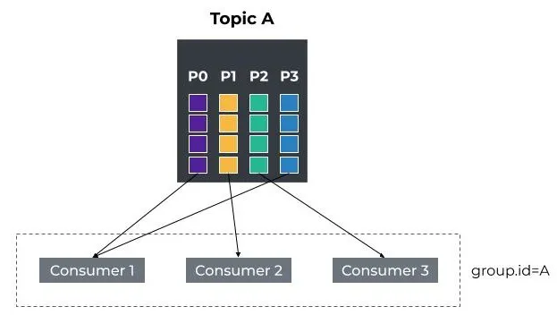

If a consumer leaves the group after a controlled shutdown or crashes then all its partitions will be reassigned automatically among other consumers. In the same way, if a consumer (re)join an existing group then all partitions will be also rebalanced between the group members.

The ability of consumers clients to cooperate within a dynamic group is made possible by the use of the so-called **Kafka Rebalance Protocol**.

Let's deep dive into this protocol to understand how it works.

### The Rebalance Protocol, in a Nutshell

First, let's give a definition of the meaning of the term "**rebalance**" in the context of Apache Kafka.

> Rebalance/Rebalancing: the procedure that is followed by a number of distributed processes that use Kafka clients and/or the Kafka coordinator to form a common group and distribute a set of resources among the members of the group (source: [Incremental Cooperative Rebalancing: Support and Policies](https://cwiki.apache.org/confluence/display/KAFKA/Incremental+Cooperative+Rebalancing%3A+Support+and+Policies)).

This definition above actually makes no reference to the notion of consumers or partitions. Instead, it uses a concept of **members** and **resources**. The main reason for that is because the rebalance protocol is not only limited to manage consumers but can also be used to coordinate any group of processes.

Here are some usages of the protocol rebalance:

- **Confluent Schema Registry** relies on rebalancing to elect a leader node.
- **Kafka Connect** uses it to distribute tasks and connectors among the workers.
- **Kafka Streams** uses it to assign tasks and partitions to the application streams instances.

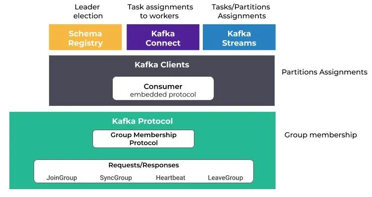

In addition, what is really important to understand is that the rebalance mechanism is actually structured around two protocols: **Group Membership Protocol** and **Client Embedded Protocol**.

The Group Membership Protocol, as its name suggests, this protocol is in charge of the coordination of members within a group. The clients participating in a group will execute a sequence of requests/responses with a Kafka broker that acts as **coordinator**.

The second protocol is executed on the client side and allows extending the first one by being embedded in it. For example, the protocol used by consumers will assign topic-partition to members.

Now that we have a better understanding of what the rebalance protocol is, let's illustrate its implementation for assigning partitions in a consumer group.

**JoinGroup**

When a consumer starts, it sends a first `FindCoordinator` request to obtain the Kafka broker coordinator which is responsible for its group. Then, it initiates the rebalance protocol by sending a `JoinGroup` request.

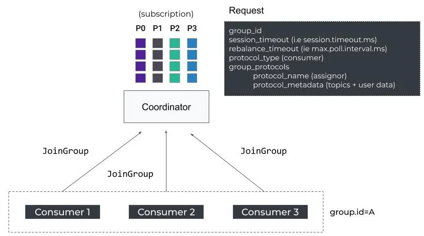

As we can see, the `JoinGroup` contains some consumer client configuration such as the `session.timeout.ms` and the `max.poll.interval.ms`. These properties are used by the coordinator to kick members out of the group if they don't respond.

In addition, the request also contains two very important fields: the list of client protocols, supported by the members, and metadata that will be used for executing one of the embedded client protocols. In our case, the client-protocols are the list of partition assignors configured for the consumer (i.e: `partition.assignment.strategy`). Metadata contains the list of topics the consumer has subscribed to.

Note that if you don't know what these properties are for, I invite you to read the [official documentation](https://kafka.apache.org/documentation/#consumerconfigs).

The `JoinGroup` acts as a barrier, meaning that the coordinator doesn't send responses as long as all consumer requests are not received (i.e `group.initial.rebalance.delay.ms)` or rebalance timeout is reached.

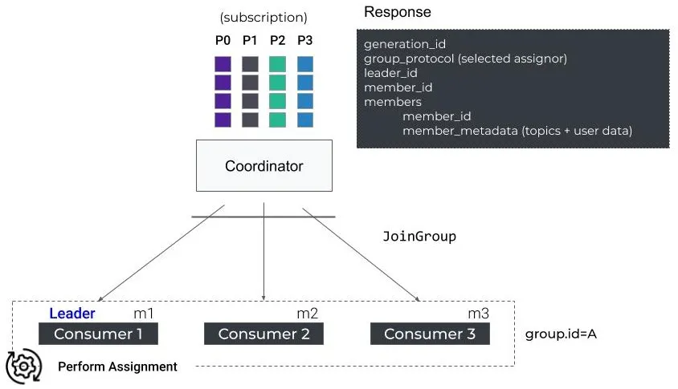

The first consumer, within the group, receives the list of active members and the selected assignment strategy and acts as **the group leader** while others receive an empty response. The group leader is responsible for executing the partitions assignments locally.

**SyncGroup**

Next, all members send a `SyncGroup` request to the coordinator. The group leader attached the computed assignments while others simply respond with an empty request.

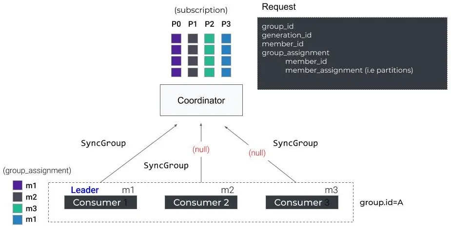

Once the coordinator responds to all `SyncGroup` requests, each consumer receives their assigned partitions, invokes the `onPartitionsAssignedMethod` on the configured listener and, then starts fetching messages.

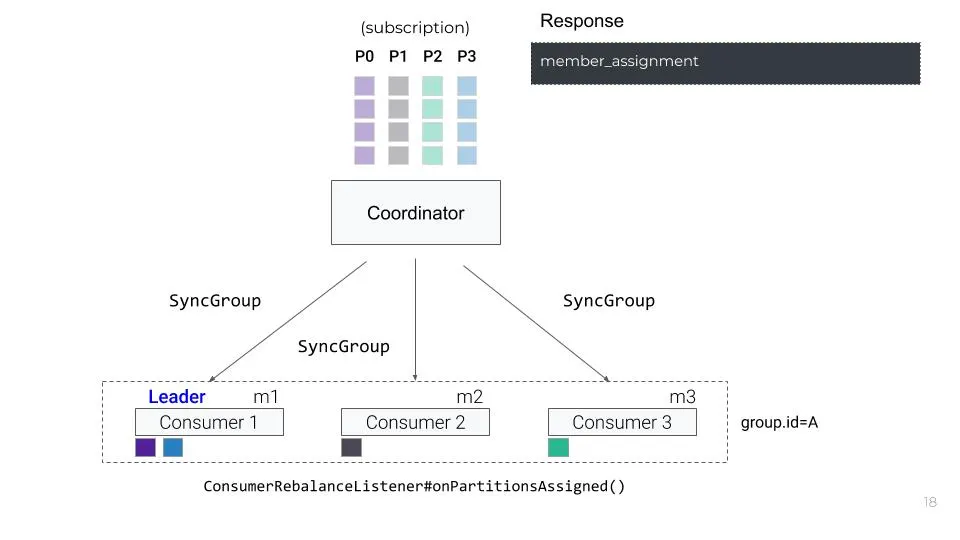

**Heartbeat**

Last but not least, each consumer periodically sends a `Heartbeat` request to the broker coordinator to keep its session alive (see: `heartbeat.interval.ms`).

If a rebalance is in progress, the coordinator uses the `Heartbeat` response to indicate to consumers that they need to rejoin the group.

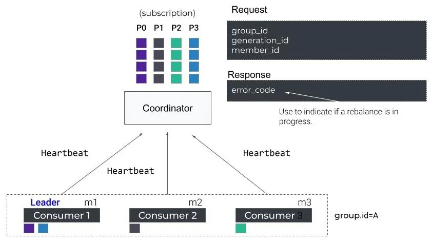

So far so good, but as you should know in a real-life situation and more especially in a distributed system, failures will happen. Hardware can fail. The network or a consumer can have transient failures. Unfortunately, for all these situations a rebalance can also be triggered.

### Some caveats

The first limitation of the rebalance protocol is that we cannot simply rebalance one member without stopping the whole group (*stop-the-world effect*).

For example, let's properly stop one of our instances. In this first rebalance scenario, the consumer will send a `LeaveGroup` request to the coordinator, before stopping.

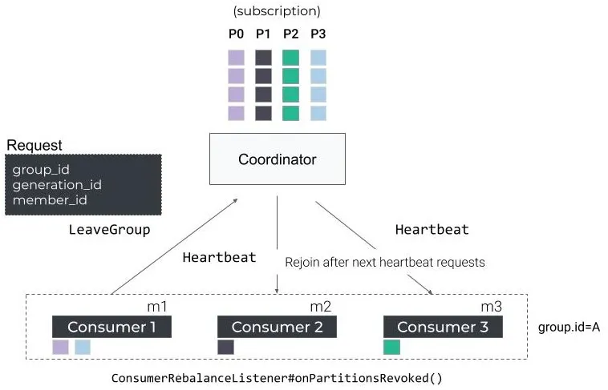

Remaining consumers will be notified that a rebalance must be performed on the next `Heartbeat` and will initiate a new `JoinGroup/SyncGroup` round-trip in order to reassign partitions.

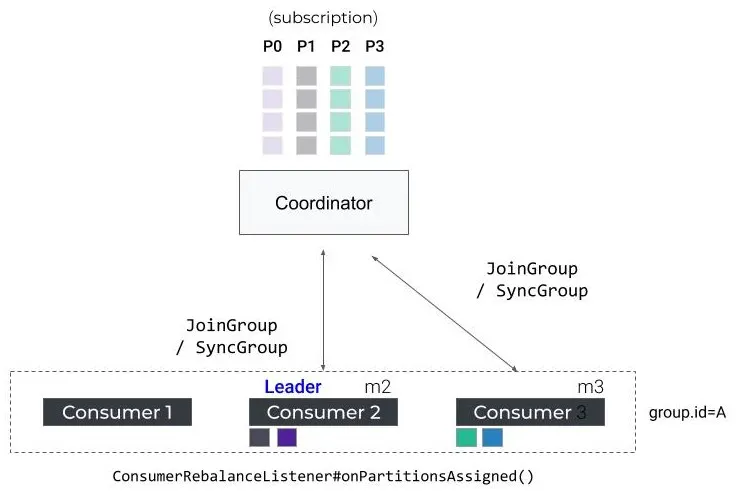

During the entire rebalancing process, i.e. as long as the partitions are not reassigned, consumers no longer process any data. By default, the rebalance timeout is fixed to 5 minutes which can be a very long period during which the increasing consumer-lag can become an issue.

But what would happen, if, for example, the consumer was just restarting after a transient failure? Well, the consumer, while rejoining the group, will trigger a new rebalance causing all consumers to be stopped (once again).

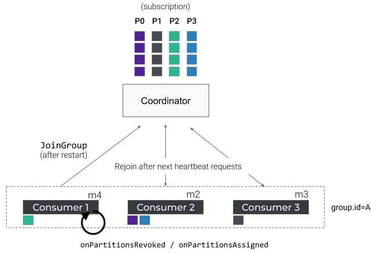

Another reason that can lead to a restart of a consumer is a rolling upgrade of the group. This scenario is unfortunately disastrous for the consumption group. Indeed, with a group of three consumers, such operation will trigger 6 rebalances that could potentially have a significant impact on messages processing.

Finally, a common problem when running Kafka consumers, in Java, is either missing a heartbeat request, due to a network outage or a long GC pause, or not invoking the method `KafkaConsumer#poll()`, periodically, due to an excessive processing time. In the first case, the coordinator is not receiving a heartbeat for more than `session.timeout.ms` milliseconds and considers the consumer dead. In the second one, the time needed for processing polled records is superior to `max.poll.interval.ms`.

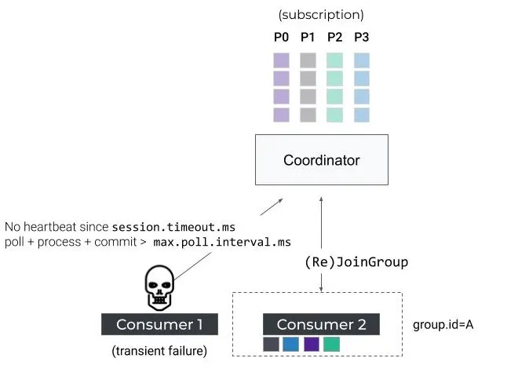

## Static Membership

To reduce consumer rebalances due to transient failures, Apache Kafka 2.3 introduces the concept of Static Membership with the [KIP-345](https://cwiki.apache.org/confluence/display/KAFKA/KIP-345%3A+Introduce+static+membership+protocol+to+reduce+consumer+rebalances).

The main idea behind static membership is that each consumer instance is attached to a unique identifier configured with `group.instance.id`. The membership protocol has been extended so that ids are propagated to the broker coordinator through the `JoinGroup` request.

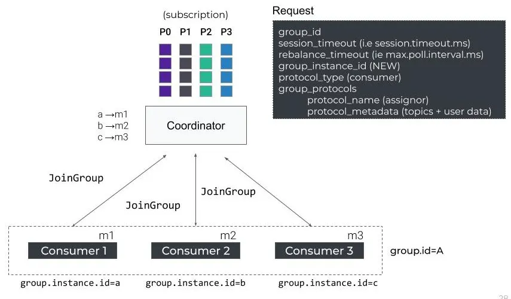

If a consumer is restarted or killed due to a transient failure, the broker coordinator will not inform other consumers that a rebalance is necessary until `session.timeout.ms` is reached. One reason for that is that consumers will not send `LeaveGroup` request when they are stopped.

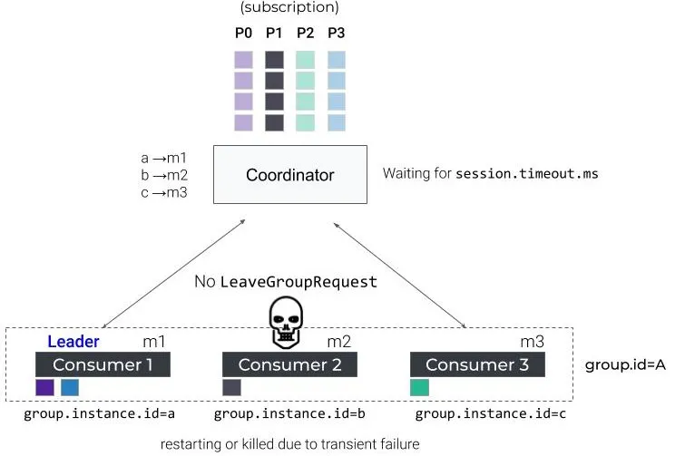

When the consumer will finally rejoin the group, the broker coordinator will return the cached assignment back to it, without doing any rebalance.

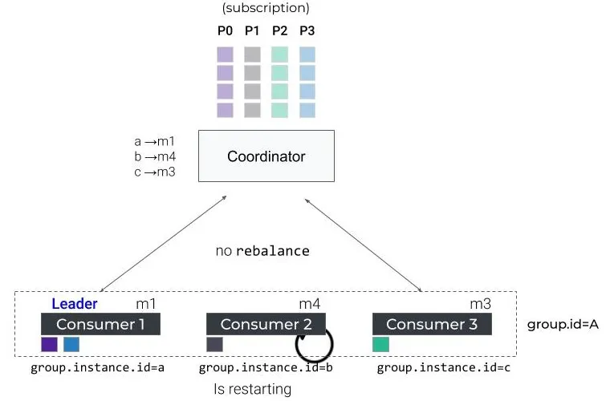

When using static membership, it's recommended to increase the consumer property `session.timeout.ms` large enough so that the broker coordinator will not trigger rebalance too frequently.

On the one hand, static membership can be very useful for limiting the number of undesirable rebalances and thus minimizing stop-the-world effect. On the other hand, this has the disadvantage of increasing the unavailability of partitions because the coordinating broker may only detect a failing consumer after a few minutes (depending on `session.timeout.ms`). Unfortunately, this is the eternal trade-off between availability and fault-tolerance you have to make in a distributed system.

## Incremental Cooperative Rebalancing

As of version 2.3, Apache Kafka also introduces new embedded protocols to improve the resource availability of each member while minimizing stop-the-world effect.

The basic idea behind these new protocols, is to perform rebalancing incrementally and in cooperation — In other words, it means executing multiple rebalance rounds rather than a global one.

Incremental Cooperative Rebalancing was first implemented for Kafka Connect through the KIP-415 (partially implemented in Kafka 2.3). Moreover, it will be available for streams and consumers from Kafka 2.4 through the KIP-429.

### Kafka Connect Limitations

Kafka Connect uses the group membership protocol to distribute connectors and tasks evenly among workers that compose a connect cluster. Thus, workers coordinate each other to rebalance connectors and tasks when a node fails/restart, tasks scales up/down and when configuration is submitted/updated.

However, before Kafka 2.3, whenever one of these scenarios occurred, the execution of all existing connectors was interrupted (i.e stop-the-world). Therefore, it was difficult to scale up a mutualized cluster with several dozens of connectors.

The Incremental Cooperative Rebalancing attempts to solve this problem in two ways:

1. Only stop tasks/members for revoked resources.
2. Handle temporary imbalances in resource distribution among members, either immediately or deferred (useful for rolling restart).

For doing that, the Incremental Cooperative Rebalancing principle is actually declined into three concrete designs:

- **Design I: Simple Cooperative Rebalancing**
- **Design II: Deferred Resolution of Imbalance**
- **Design III: Incremental Resolution of Imbalance**

To give you a better understanding on how Incremental Cooperative Rebalancing works we are going to illustrate the design II in the context of Kafka Connect.

### Deferred Resolution of Imbalance

First, let's start with a simple connect cluster composed of three workers with this initial task/connector assignment:

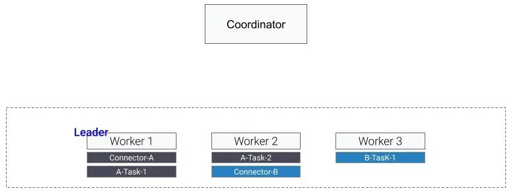

Now, let's imagine that W2 fails without any particular reason and leaves the group by session timeout. A rebalance is triggered and remaining workers W1 and W3 rejoin the group. While sending a `JoinGroup` request workers include their previous assignment. Assignments are shared using the existing field `member_metadata` of the Group Membership protocol.

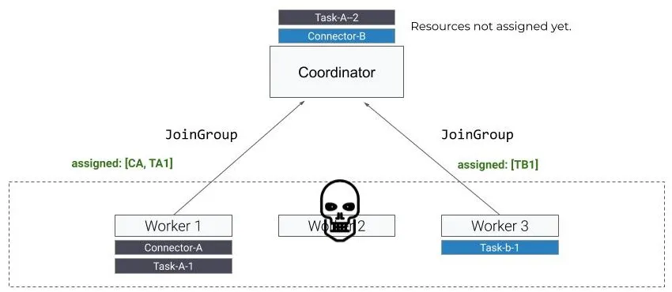

W1 is elected as the group leader and performs tasks/connectors assignments by computing the difference with the previous assignments. Here, the leader detects that some task and connector are not present in previous assignments.

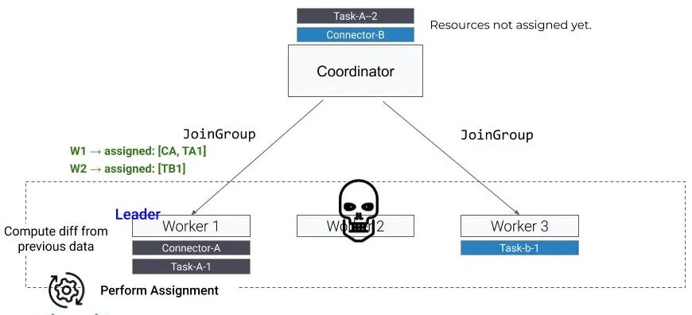

W1 sends the new assigned tasks/connectors as well as revoked. You can note that W1 will not actually try to resolve immediately missing assignment (or imbalance). Instead of that, it will defer the resolution by scheduling a next rebalance to get a chance to the failing member to reappear. The scheduling delay is fixed by a new configuration `scheduled.rebalance.max.delay.ms` (by default, it is equal to 5 minutes).

Note: With Incremental Cooperative Rebalancing, when a member receives a new assignment, it will start processing any new partitions (or tasks/connector). Moreover, if the assignment also contains revoked partitions then it stops processing, commit and then initiate another join group immediately. This has the effect of increasing the number of rebalancing but only stopping the resources whose assignment has changed.

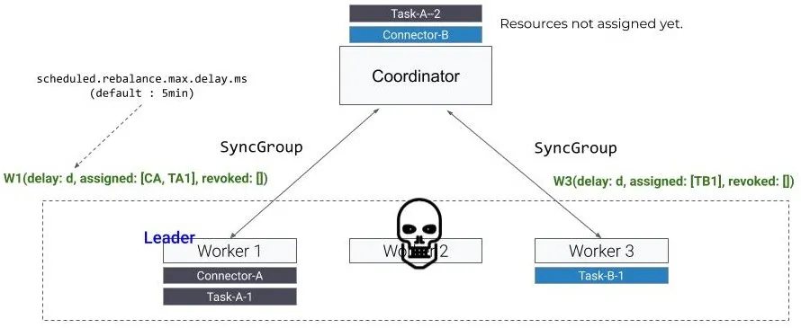

W2 rejoins the group before delay expires and another rebalance is triggered. W1 and W2 also rejoin the group.

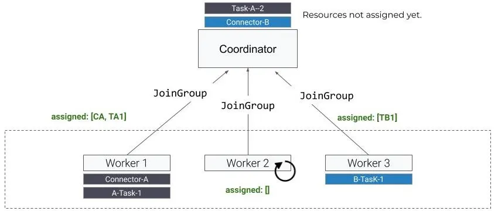

However, W1 will not reassign missing task/connector until the scheduled rebalance delay expires.

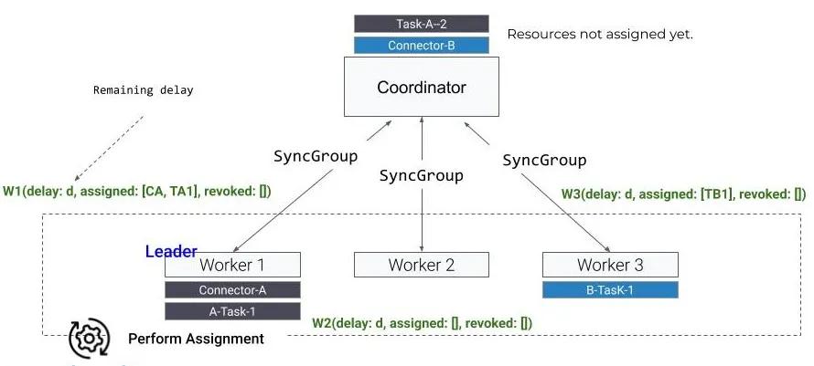

After the remaining delay expires, a final rebalance is triggered and all workers rejoin the group.

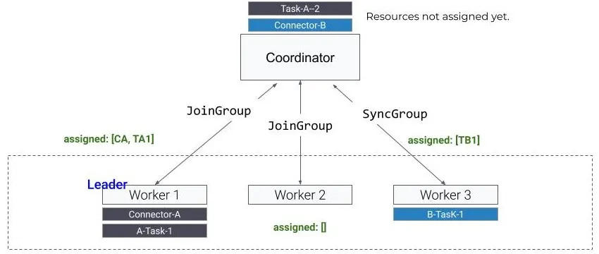

Finally, the group leader reassigned A-Task-1 and Connector-B to W2. During all the rebalance sequence, W1 and W3 never stopped their assigned tasks.

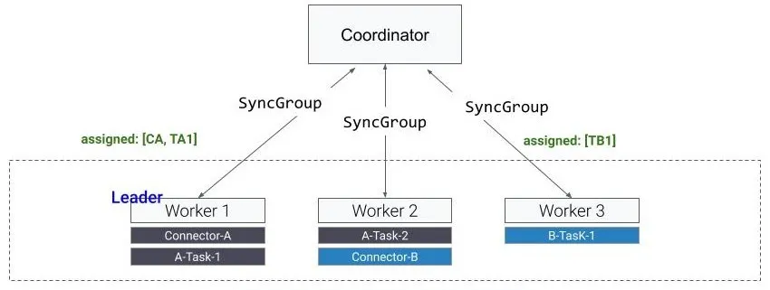

## Conclusion

The rebalancing protocol is an essential component of the consumption mechanism in Apache Kafka. But, it also serves as a generic protocol for coordinating group members and distributing resources among them (e.g Kafka Connect). Static Membership and Incremental Cooperative Rebalancing are both important features which provides a huge improvement to Apache Kafka by making this protocol more robust and scalable.

To learn more about the rebalance protocol and how it works have a look to the following links.

**Sources:**

- [KIP-429](https://cwiki.apache.org/confluence/display/KAFKA/KIP-429%3A+Kafka+Consumer+Incremental+Rebalance+Protocol), [KIP-415](https://cwiki.apache.org/confluence/display/KAFKA/KIP-415%3A+Incremental+Cooperative+Rebalancing+in+Kafka+Connect), [KIP-453](https://cwiki.apache.org/confluence/display/KAFKA/KIP-345:+Introduce+static+membership+protocol+to+reduce+consumer+rebalances)
- [Incremental Cooperative Rebalancing: Support and Policies](https://cwiki.apache.org/confluence/display/KAFKA/Incremental+Cooperative+Rebalancing%3A+Support+and+Policies)
- [Apache Kafka Protocol](https://kafka.apache.org/protocol)
- [The Magical Rebalance Protocol of Apache Kafka by Gwen Shapira](https://www.youtube.com/watch?v=MmLezWRI3Ys)
