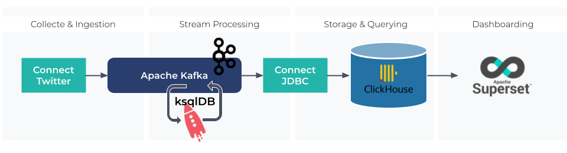
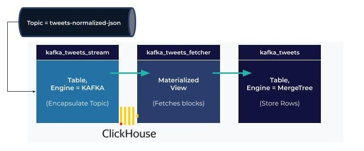
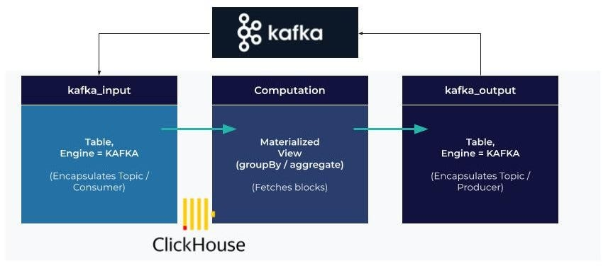
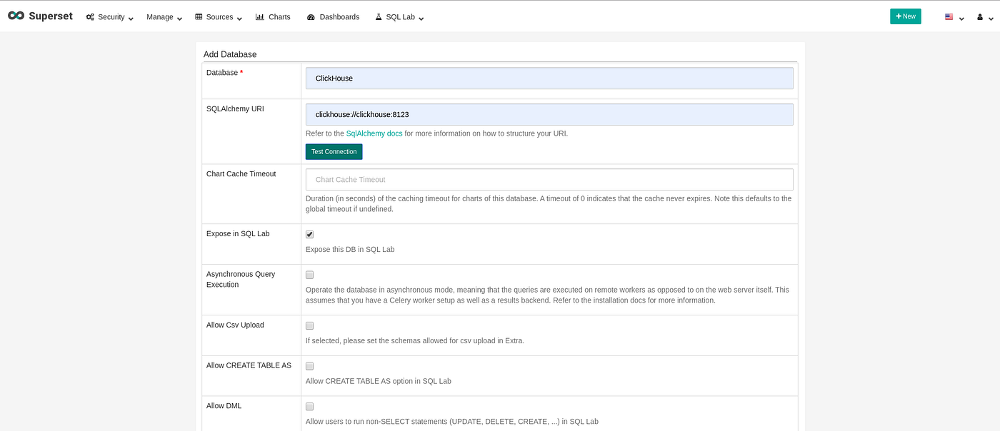
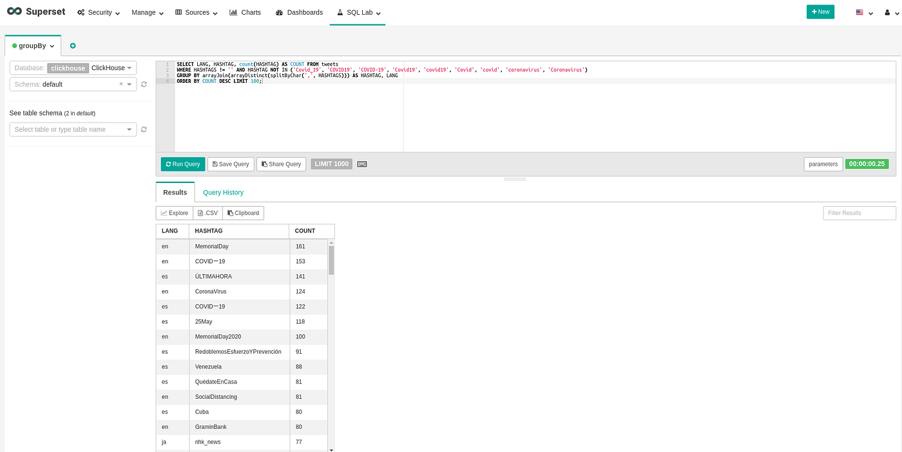
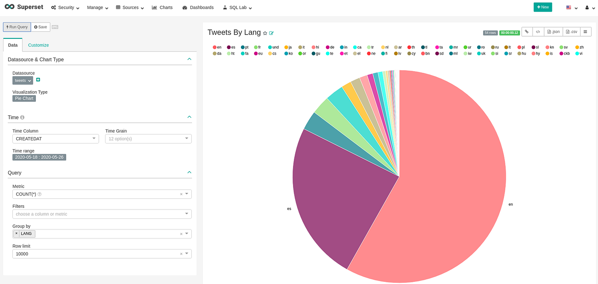

+++
author = "Florian Hussonnois"
title = "How to build a real-time analytics platform using Kafka, ksqlDB and ClickHouse ?"
date = "2020-06-02"
tags = [
    "apache kafka",
    "ksqldb",
    "clickhouse",
    "kafka connect",
    "data",
]
draft = false
image = "/images/posts/kafka-ksqldb-clickhouse/cover.png"
+++


*Apache Kafka + ksqlDB + ClickHouse + Superset = Blazing Fast Analytics Platform*

_This blog post was originally published on [Medium](https://medium.com/streamthoughts/how-to-build-a-real-time-analytical-platform-using-kafka-ksqldb-and-clickhouse-bfabd65d05e4)_

Recently at StreamThoughts, we have looked at different open-source OLAP databases that we could quickly experiment in a streaming architecture, based on the [Apache Kafka](https://kafka.apache.org/) platform.

Our goal was to be able to respond to analytical needs on large volumes of data that were ingested in real-time. For this, we were looking for a solution that would allow us to execute ad-hoc queries, interactively, with “acceptable” latencies (a few seconds or more).

In addition, to allow us to quickly evaluate different ideas, we were looking for a solution that:

- Is easy to setup out-of-the-box.
- Offers a SQL-like query language (with JDBC support if possible).
- Is not coupled with the Hadoop ecosystem.
- Can be integrated with a data visualization solution such as [Apache Superset](https://superset.apache.org/).

Finally, and more generally, we wanted to evaluate a solution that is, on the one hand, elastic (i.e that can scale from tens to hundreds of nodes), and, on the other hand, that has a data replication mechanism to cope with classical high availability and fault tolerance requirements.

We finally decided to experiment [ClickHouse](https://clickhouse.tech/).

In this article, we will see how to integrate this solution into the Apache Kafka ecosystem, step by step, using an example of a Tweets analysis application.

The diagram below shows the global architecture of our streaming platform:



*Global Architecture Overview*

## Step 1: Collecting and ingesting data from Twitter

The first step is to deploy our data ingestion platform and the service that will be responsible for collecting and publishing tweets (using the Twitter API) into a Kafka topic.

For this, we will use Docker to quickly set up the several services that compose our streaming platform: Zookeeper, Kafka, Schema-Registry and ksqlDB.

- Download or clone the demo project from GitHub:
```bash
$ $ git clone https://github.com/streamthoughts/demo-twitter-ksqldb-clickhouse.git
```
- Compile the Maven module which contains some ksqlDB functions that will be useful later.
```bash
$ cd demo-twitter-ksqldb-clickhouse
$ (cd ./ksql-custom-udfs; mvn clean package)
```
- Then, start [ksqlDB](https://ksqldb.io/) and the other services using the following `docker-compose` command:
```bash
$ docker-compose up -d ksqldb-server
```
- You can easily list all the services (i.e containers) currently running:
```bash
$ docker ps --format "{{.ID}}/{{.Names }} ({{.Status}}"
afd0d835c91d/ksqldb-server (Up 6 minutes)
2ae4b0560bc7/kafka-connect (Up 6 minutes (health: starting))
53dd5a1a8c0b/schema-registry (Up 6 minutes)
3c105ef1eb5d/kafka (Up 6 minutes)
bfecffd69ae4/zookeeper (Up 6 minutes)
```
- Finally, to check if ksqlDB is running properly, execute the following command:
```bash
$ curl -sX GET http://localhost:8088/info | jq .
{
 "KsqlServerInfo": {
 "version": "0.8.1",
 "kafkaClusterId": "tlsv3OECQDucoA6-ZdpkxQ",
 "ksqlServiceId": "ksql-docker"
 }
}
```

### ksqlDB & Kafka Connect

We can now use ksqlDB to directly start a Kafka connector to collect the Tweets we are interested in. For this project, we will use the open-source [TwitterSourceConnector](https://github.com/jcustenborder/kafka-connect-twitter) available that is available on [Confluent Hub](https://www.confluent.io/hub/jcustenborder/kafka-connect-twitter).

If you take a look at the `docker-compose.yml` file, you will notice that we have given ksqlDB the address of the Kafka Connect worker. The worker is deployed using a custom Docker image that packs with all the connectors required for our demonstration project.

Before you can deploy a new instance of this connector, make sure to have access to the [Twitter Developer API](https://developer.twitter.com/en/docs/basics/authentication/oauth-1-0a). For this, you have to create an access token and secret from your twitter apps page.

- Create a topic named `tweets` using the following command:
```bash
$ docker exec -it kafka kafka-topic \
--zookeeper zookeeper:2181 \
--create --topic tweets \
--partitions 4 \
--replication-factor 1
```
- Start the ksqlDB client:
```bash
$ docker exec -it ksqldb-server ksql

KSQL, Copyright 2017–2019 Confluent Inc.

CLI v5.4.1, Server v5.4.1 located at http://localhost:8088

Having trouble? Type ‘help’ (case-insensitive) for a rundown of how things work!

ksql>
```
- Create a new `TwitterSourceConnector` instance:
```sql
ksql> CREATE SOURCE CONNECTOR `tweeter-connector` WITH ( 'connector.class'='com.github.jcustenborder.kafka.connect.twitter.TwitterSourceConnector',
 'twitter.oauth.accessTokenSecret'='********',
 'twitter.oauth.consumerSecret'='********',
 'twitter.oauth.accessToken'='********',
 'twitter.oauth.consumerKey'='********',
 'kafka.status.topic'='tweets',
 'process.deletes'=false,
 'filter.keywords'='coronavirus,2019nCoV,SARSCoV2,covid19,cov19'
);

 Message 
 — — — — — — — — — — — — — — — — — — -
 Created connector tweeter-connector 
 — — — — — — — — — — — — — — — — — — -
ksql>
```

*Note: In the statement above, you have to update the 4 properties prefixed with* `*twitter.oauth.**` *with your generated Twitter credentials.*

- Let’s check that our connector is working properly by querying the Kafka Connect REST API:
```bash
$ curl \
-H "Content-Type:application/json" \
-X GET \
 http://localhost:8083/connectors/tweeter-connector/status | jq
```

(output)

```json
{
  "name": "tweeter-connector",
  "connector": {
    "state": "RUNNING",
    "worker_id": "connect:8083"
  },
  "tasks": [
    {
      "id": 0,
      "state": "RUNNING",
      "worker_id": "connect:8083"
    }
  ],
  "type": "source"
}
```

Now, that the connector is up and running, it will start to produce Avro records into the topic named `tweets`.

- To display the ingested tweets, we define a new **KSQL STREAM** based on the topic `tweets`.
```sql
ksql> CREATE STREAM tweets WITH (KAFKA_TOPIC = 'tweets', VALUE_FORMAT='AVRO');
```
- Finally, execute the following KSQL query:
```sql
ksql> SELECT Text FROM tweets EMIT CHANGES LIMIT 5;
```

## Step 2: Transform

The source connector is now deployed and we are ingesting tweets in real-time. But, the data published by the `TwitterSourceConnector` contains several fields with a complex data structure that will be difficult to query in the later stages. Usually, it is easier to work on a flat data structure that only contains primitive types.

- To inspect the schema of the tweets records, you can run the following KSQL statement:
```sql
ksql> DESCRIBE EXTENDED TWEETS;
```

Since only a subset of fields is relevant to this project, it is simpler to filter records before inserting them into the target database. To do so, we will use ksqlDB to easily transform the ingested records as they arrive.

### ksqlDB & Push Queries

ksqlDB defines a concept of [*push query*](https://docs.ksqldb.io/en/latest/concepts/queries/push/) that will allow us to consume the previously defined ksqlSTREAM named `TWEETS`, to apply a transformation on each record and to finally send the output records to a new STREAM materialized as a Kafka topic named `tweets-normalized`. This important to note that a *push query* will run forever.

- Create a topic named `tweets-normalized` using the following command:
```bash
$ docker exec -it kafka kafka-topic \
--zookeeper zookeeper:2181 \
--create --topic tweets-normalized \
--partitions 4 \
--replication-factor 1
```
- Execute the following KSQL query to define a new STREAM named`TWEETS_NORMALIZED`:
```sql
ksql>
CREATE STREAM TWEETS_NORMALIZED
  WITH (kafka_topic = 'tweets-normalized') AS
  SELECT
    Id,
    CreatedAt / 1000 as CreatedAt,
    Text,
    Lang,
    Retweeted,
    User->Id as UserId,
    User->Name as UserName,
    IFNULL(User->Description, '') as UserDescription,
    IFNULL(User->Location, '') as UserLocation,
    ARRAY_TO_STRING( EXTRACT_ARRAY_FIELD(UserMentionEntities, 'Name'), ',', '') as Mentions,
    ARRAY_TO_STRING( EXTRACT_ARRAY_FIELD(HashtagEntities, 'Text'), ',', '') as Hashtags
FROM tweets EMIT CHANGES;
```
- To inspect the resulting output of the *push query* run the followings:
```sql
ksql> SELECT * FROM TWEETS_NORMALIZED EMIT CHANGES;
```

### User-Defined Function (UDF)

It is pretty easy to extend ksqlDB through the use of User-Defined Functions. Thus, to facilitate the extraction of hashtags and mentions, present in each tweet, we have defined the following two UDFs:

- **EXTRACT\_ARRAY\_FIELD:** Extracts a specific field from a field of type `Array<Struct>`.
- **ARRAY\_TO\_STRING:** Joins all elements from an `Array` as a `String` using a given delimiter.

The source code for the UDFs is available on the [GitHub repository](https://github.com/streamthoughts/demo-twitter-ksqldb-clickhouse/tree/master/ksql-custom-udfs).

## Step 3: Store and query data

Before analyzing the ingested tweets, we have to store records in ClickHouse.


### ClickHouse

[ClickHouse](https://clickhouse.tech/) is an open-source (Apache License 2.0), OLAP (Online Analytical Processing) database originally developed by the company Yandex, for the needs of its Metrica solution (similar to Google Analytics). Yandex is the first search engine used in Russia.

ClickHouse was developed with a simple objective: to filter and aggregate as much data as possible as quickly as possible. Similar to other solutions of the same type (eg. Druid, Pinot), ClickHouse uses a column-oriented model for data storage. It also relies on various parallelization and vectorization mechanisms to take the most advantage of multi-core architectures. Hence, Clickhouse can support data volumes of several petabytes.

**Deploying ClickHouse instance**

A ClickHouse database can be deployed either as a single node or as a cluster of several nodes allowing the implementation of different sharding and replication strategies. ClickHouse relies on Zookeeper to store replication-related metadata.

For that article, we will use a single ClickHouse instance deployed via Docker.

*Note: In ClickHouse, each data inserts into a replicated table will lead to multiple transactions being run in Zookeeper. The Zookeeper can therefore quickly become a bottleneck. So for a production environment, it will be recommended not to mutualize the Zookeeper cluster used by Apache Kafka for ClickHouse purposes.*

### Inserting data into ClickHouse

- Run a single-node Clickhouse instance.
```bash
$> docker-compose up -d clickhouse
```
- Then, create a table named `tweets` after starting a clickhouse client as follows:
```bash
$ docker exec -it clickhouse bin/bash -c "clickhouse-client --multiline"
```

(ClickHouse CLI)

```sql
clickhouse :) CREATE TABLE IF NOT EXISTS default.tweets
(
    ID UInt64,
    CREATEDAT DateTime,
    TEXT String,
    LANG String,
    RETWEETED UInt8,
    USERID UInt64,
    USERNAME String,
    USERDESCRIPTION String,
    USERLOCATION String,
    HASHTAGS String,
    MENTIONS String
) ENGINE = MergeTree()
PARTITION BY toYYYYMM(CREATEDAT)
ORDER BY (CREATEDAT, LANG);
```

To consume records from Kafka and integrate them directly into ClickHouse, we will use Kafka Connect for the second time by deploying an instance of the [JDBC Kafka Connector](https://github.com/confluentinc/kafka-connect-jdbc) JDBC (Sink) via ksqlDB. Before this, we have taken care to download and install the ClickHouse JDBC driver in the classpath directory of worker connect.

- Create a new Connect JDBC instance via ksql.
```sql
ksql> CREATE SOURCE CONNECTOR `clickhouse-jdbc-connector` WITH (
    'connector.class'='io.confluent.connect.jdbc.JdbcSinkConnector',  
    'topics'='tweets-normalized',
    'tasks.max'='1',
    'connection.url'='jdbc:clickhouse://clickhouse:8123/default',
    'table.name.format'='tweets'
);
```
- You should now be able to query the ClickHouse table named `tweets`.
```bash
$ docker exec -it clickhouse bin/bash -c "clickhouse-client -q 'SELECT COUNT(*) AS COUNT, LANG FROM tweets GROUP BY LANG ORDER BY (COUNT) DESC LIMIT 10;'"
```

(output):

```text
┌─COUNT─┬─LANG─┐
│ 66896 │ en   │
│ 20577 │ es   │
│  4076 │ fr   │
│  3070 │ und  │
│  2555 │ pt   │
│  1443 │ it   │
│  1393 │ in   │
│  1284 │ ja   │
│   970 │ ca   │
│   867 │ hi   │
└───────┴──────┘

10 rows in set. Elapsed: 0.013 sec. Processed 107.24 thousand rows, 1.18 MB (8.50 million rows/s., 93.74 MB/s.)
```

### Some caveats

Although the previously proposed solution works, it is far from being effective, as it is, for a production context. Indeed, ClickHouse does not support real-time data ingestion, i.e. record by record. The documentation recommends performing inserts in batches of at least 1000 records, or no more than one insertion per second.

It is therefore essential to [configure the connector](https://docs.confluent.io/current/connect/kafka-connect-jdbc/sink-connector/sink_config_options.html) to maximize the number of records per insertion, especially using the `batch.size` property (default: 3000).

Additionally, it may be necessary to modify the default configuration for consumers internal to the connector to fetch a maximum of records from the brokers in a single query (`fetch.min.bytes`, `fetch.max.bytes`, `max.poll.records`, `max.partition.fetch.bytes`).

Unfortunately, depending on your use case and your input data throughput the changing configuration may not be sufficient to optimize writes into ClikHouse.

### Alternative solutions

Various alternatives to the one described above can be considered for real-time data insertion in ClickHouse.

**Alternative n°1: Buffer Table Engine**

ClickHouse provides a mechanism called “[**Table Engine**](https://clickhouse.tech/docs/en/engines/table-engines/)” that allows defining where and how the data in a table is stored, as well as to define the mechanisms for accessing, indexing and replicating data.

ClickHouse packs with various TableEngine families as well as special engines, such as the `BUFFER`type.

Basically, a `BUFFER` type table allows, as its name suggests, to buffer raws in memory before flushing them periodically in another table.

For our use-case, that solution seems ideal since it would guarantee Clickhouse’s performance, over time, regardless of the number of inserts.

Unfortunately, the `BUFFER` type is not a standard SQL type and is therefore currently not compatible with Confluent’s JDBC connector, which does not recognize the existence of such a table.

Therefore, to use the ClickHouse `BUFFER` table engine, either a new connector would have to be developed or the existing JDBC connector would have to be modified to support custom table types.

**Alternative n°2: Using the built-in Kafka Integration**

Additionally, ClickHouse provides a special Table Engine to encapsulate a Kafka topic as an “SQL Table”.

The following statement shows how to create a table with the Kafka engine:

```sql
$ docker exec -it clickhouse bin/bash -c "clickhouse-client --multiline"

clickhouse :) CREATE TABLE kafka_tweets_stream (
    ID UInt64,
    CREATEDAT DateTime,
    TEXT String,
    LANG String,
    RETWEETED UInt8,
    USERID UInt64,
    USERNAME String,
    USERLOCATION String,
    HASHTAGS String,
    MENTIONS String
  ) ENGINE = Kafka SETTINGS 
    kafka_broker_list = 'kafka:29092',
    kafka_topic_list = 'tweets-normalized-json',
    kafka_group_name = 'ch-tweet-group',
    kafka_format = 'JSONEachRow',
    kafka_skip_broken_messages = 1,
    kafka_num_consumers = 1;
```

You can notice that, in the above statement, we create a table from the topic named `tweets` that contains records in JSON (`JSONEachRow`) format.

Clickhouse supports the Avro format with the use of the Confluent SchemaRegistry. But, as of writing, it does not support Avro UNION types. So, to simplify things, we will first convert our Avro stream to JSON using the following KSQL query:

```sql
ksql > CREATE STREAM TWEETS_NORMALIZED_JSON 
WITH (KAFKA_TOPIC='tweets-normalized-json',VALUE_FORMAT='JSON') 
AS SELECT * FROM TWEETS_NORMALIZED;
```

It is important to understand that the table we have created does not store any data but rather allows the creation in the background of one or more consumers attached to the same *Consumer Group*. Therefore, the `kafka_tweets_stream` table is more of a real-time *data stream* than an SQL table.

To illustrate this, you can execute the following SQL query several times:

```sql
$ docker exec -it clickhouse bin/bash -c "clickhouse-client --multiline"

clickhouse :) SELECT * FROM kafka_tweets_stream ;
```

You will then notice that Clickhouse only returns the last records consumed from the topic. This is because the table takes the form of a real-time data stream in which messages can only be consumed once.

So, to take full advantage of this table we will create a second table that will be populated by this one through a *Materialized View* that will serve as a *fetcher* in a similar way to our SELECT.

The diagram below illustrates how the different tables interact with each other:



*ClickHouse — Apache Kafka Integration — Consumer*

- First, let’s create a table named `kafka_tweets` used to store the records that will be fetched from the table `kafka_tweets_stream`. Both tables have the same schema.
```sql
clickhouse :) CREATE TABLE kafka_tweets AS kafka_tweets_stream
ENGINE = MergeTree() 
PARTITION BY toYYYYMM(CREATEDAT)
ORDER BY (CREATEDAT, LANG);
```
- Then, we create the *Materialized View* named `kafka_tweets_fetcher` that will be responsible to populate the `kafka_tweets` table by fetching records from the table `kafka_tweets_stream`.
```sql
clickhouse :) CREATE MATERIALIZED VIEW kafka_tweets_consumer
TO kafka_tweets
AS SELECT * FROM kafka_tweets_stream;
```

*Note: Internally, ClickHouse relies on librdkafka the C++ library for Apache Kafka. It is possible to set configuration properties to optimize the clients.*

- Finally, you can now re-run the same query to select the data:
```sql
clickhouse :) SELECT COUNT(*) AS COUNT, LANG FROM kafka_tweets GROUP BY LANG ORDER BY (COUNT) DESC LIMIT 10;
```

The built-in Kafka integration that is shipped with ClickHouse opens up very interesting perspectives in terms of data processing, especially because it is also possible to use a table to produce data in Kafka. For example, we could create a Materialized View to aggregate incoming messages in real-time, insert the aggregation results in a table that would then send the rows in Kafka.

The diagram below shows the use of ClickHouse’s MaterializedView to transform Kafka data.



*ClickHouse — Apache Kafka Integration — Producer*

**Alternative n°3: ClickHouse Sinker**

Another and last possible solution would be to use [ClickHouse Sinker](https://github.com/housepower/clickhouse_sinker), a tool developed in Go to easily integrate messages from Kafka topics to ClickHouse. However, we didn’t take the time to test this solution.

## Step 4: Data Visualization

Finally, all we need now is to visualize our data. We can use [Apache Superset](https://superset.incubator.apache.org/) to explore data, to identify relevant queries and to build one or more dashboards.

- Start and initialize a Superset instance via Docker:
```bash
$ docker-compose up -d superset
$ docker exec -it superset superset-init
```
- Then, access to the UI using the credentials that you configure during initialization: `http://localhost:8080`.
```bash
$ docker exec -it superset superset-init
```

ClickHouse can be added as a data source by configuring the following SQLAlchemy url: `clickhouse://clickhouse:8123`



Finally, Superset brings us an easy to use interface to query our database and create charts.

Below are some basic examples:



*Superset — SQL Lab*



*Superset — Explore — Charts*

## Conclusion

More and more solutions are available to build real-time analytical platforms that do not rely on Hadoop for data storage. ClickHouse is an interesting OLAP solution that can be relatively easy to integrate into a streaming platform such as Apache Kafka.

## Sources / Resources

### ksqlDB & Kafka Connect

- [https://docs.ksqldb.io/en/latest/concepts/queries/push/](https://docs.ksqldb.io/en/latest/concepts/queries/push/)
- [https://dev.to/hpgrahsl/how-to-build-a-streaming-emojis-tracker-app-with-ksqldb-514a](https://dev.to/hpgrahsl/how-to-build-a-streaming-emojis-tracker-app-with-ksqldb-514a)

**Clickhouse & Kafka**

- Introduction to the-mysteries of clickhouse replication by Robert Hodges & Altinity Engineering Team ([slides](https://fr.slideshare.net/Altinity/introduction-to-the-mysteries-of-clickhouse-replication-by-robert-hodges-and-altinity-engineering-team))
- Fast insight from fast data integrating Clickhouse and Apache Kafka by Altinity ([slides](https://fr.slideshare.net/Altinity/fast-insight-from-fast-data-integrating-clickhouse-and-apache-kafka)).
- The Secrets of ClickHouse Performance Optimizations ([video](https://www.youtube.com/watch?v=ZOZQCQEtrz8))
- ClickHouse Primary Keys ([blog](https://medium.com/@f1yegor/clickhouse-primary-keys-2cf2a45d7324))
- Comparison of the Open Source OLAP Systems for Big Data: ClickHouse, Druid, and Pinot ([blog](https://medium.com/@leventov/comparison-of-the-open-source-olap-systems-for-big-data-clickhouse-druid-and-pinot-8e042a5ed1c7))
- ClickHouse Data Distribution ([blog](https://www.altinity.com/blog/2017/6/5/clickhouse-data-distribution))
- Circular Replication Cluster Topology in ClickHouse ([blog](https://www.altinity.com/blog/2018/5/10/circular-replication-cluster-topology-in-clickhouse))

### Others:

- CMU Advanced Database Systems — 20 Vectorized Query Execution (Spring 2019) by Andy Pavlo ([video](https://www.youtube.com/watch?v=7hgZKrFXYNs))

## About Us:

[StreamThoughts](https://www.streamthoughts.io/) is an open source technology consulting company. Our mission is to help organizations create systems and applications that reflect how their business actually work, by helping them to get easy access to their data in real-time.

We deliver high-quality professional [services](https://www.streamthoughts.io/services/apache-kafka/) and [training](https://www.streamthoughts.io/training/), in France, in data engineering, event streams technologies and the Apache Kafka ecosystem and Confluent.Inc Streaming platform.
