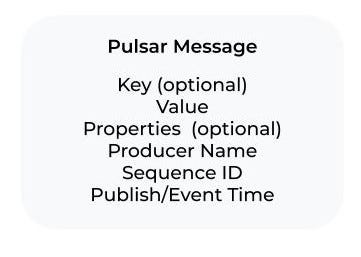
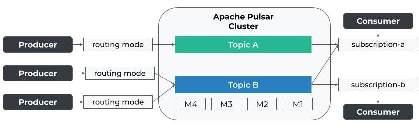
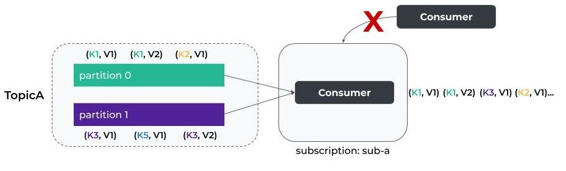
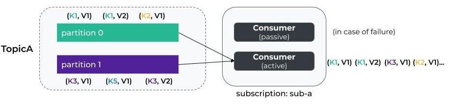
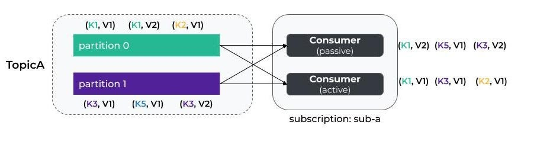
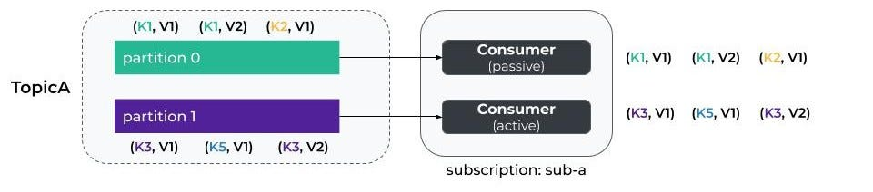
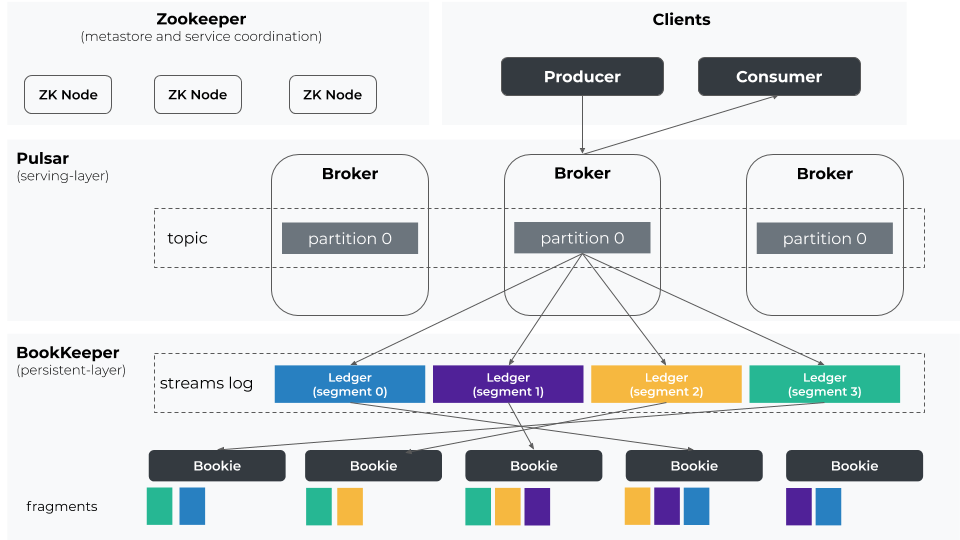
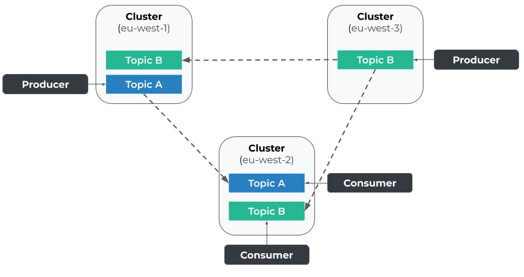
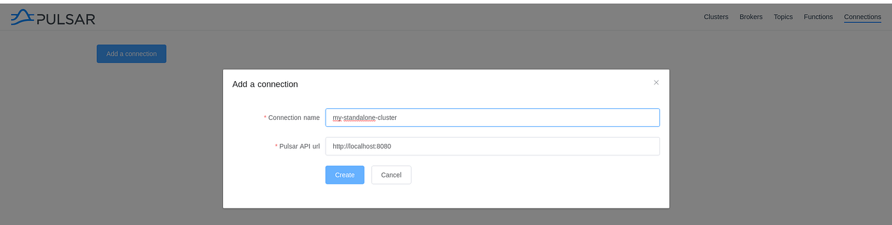
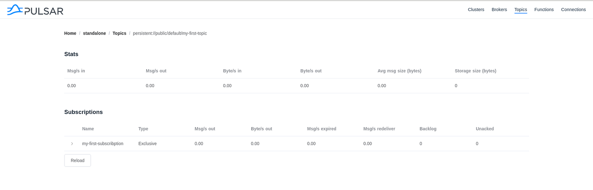

+++
author = "Florian Hussonnois"
title = "Introduction to Apache Pulsar — Concepts, Architecture & Java Clients"
date = "2019-11-12"
tags = [
    "apache pulsar",
    "event streaming",
    "java",
]
draft = false
image = "/images/posts/apache-pulsar-introduction/cover.png"
+++


_This blog post was originally published on [Medium](https://medium.com/streamthoughts/introduction-to-apache-pulsar-concepts-architecture-java-clients-71f1a30b75d6)_

People who know me know how I am a big and unconditional fan of Apache Kafka since a long time, and this may be the same for you.

But as a software consultant, I have to keep eyes open on other streaming platform competitors — and Apache Pulsar is one of them.


In this blog post, I will try to give you a broad overview of what is Apache Pulsar and how to get started with it.

*Disclaimer: This article is not a comparison between Apache Pulsar and another well-known streaming platform:)*

## Yet Another Streaming Platform, Yahoo!

[Apache Pulsar](https://pulsar.apache.org/) is an open-source distributed streaming platform which was originally created at Yahoo. It’s one of the Top Level Project of the Apache foundation since september 2018. The project is mainly developed by the company [https://streaml.io/](https://streaml.io/) (which was recently acquired by Splunk).

As of the writing of this post, the latest Apache Pulsar release is 2.4.1, the project has 4,3K stars and about 170 contributors on [GitHub](https://github.com/apache/pulsar).

## Apache Pulsar concepts and architecture

Pulsar is a distributed, multi-tenant, high-performance and fault-tolerant platform build on the publish-subscribe pattern.

In this kind of architecture, we distinguish two types of applications: producers and consumers. Also, we have concepts of topics, messages and subscriptions.

Let’s define these concepts in the context of Apache Pulsar.

### Producer

Producers are applications which publish messages into one or more topics.

Messages can be published either synchronously or asynchronously. For the first one, the producer is blocking and waits for an acknowledgement from Apache Pulsar, and, for the second one the message is queued and sent in background.

For performance consideration, messages can be batched and compressed to reduce network bandwidth. Currently, Apache Pulsar supports the following compression codecs: LZ4, ZLIB, ZSTD and SNAPPY.

### Topic

A topic is an abstraction used for grouping messages that belongs to a same business or technical context. Topics are named using an URI which respect the following structure:

```text
{type}://{tenant}/{namespace}/{topic}
```

For the moment, we can ignore the notion of “tenant” and “namespace” but let’s discuss the types:

Pulsar supports two kinds of topics:

- **persistent (default):** all messages are durably stored and replicated on disks.
- **non-persistent:** all messages are memory resident and are never persisted on disks. This means, messages can be lost in case of node failure.

By default, Pulsar will automatically create a topic if it doesn’t exist when a client (producer or consumer) attempts to produce or consume.

Finally, a topic is partitioned across an Apache Pulsar cluster. Thus, each node which composes a cluster owns a subset of the topic called a **partition**.

### Message

A message is the basic unit of Apache Pulsar and is composed of a key-value pair associated with: an optional set of user-defined properties, the producer identifier, the sequence id of the message into the topic and both an event and processing timestamps.

Also, it’s important to note that, the key is optional and the sequence id is assigned by the producer.



*Apache Pulsar — Message format*

### Routing Modes

Producers can determine how messages are distributed across the cluster nodes by specifying a routing mode. A routing mode determines the target partition for each record and therefore the delivery order of messages.

Apache Pulsar provides three routing modes:

- **RoundRobinPartition** (default): The producer publish messages or batches of messages, that do not have a specified key, across all partitions in round-robin fashion. Otherwise, if a key is specified for a message, a hash is generated and the message is sent to a specific partition.
- **SinglePartition**: The producer randomly selects one partition and sends all messages that do not have a specified key. Otherwise, if a key is specified for a message, a hash is generated and the message is sent to a specific partition.
- **CustomPartition:** If none of the previous routing modes are suitable for you, the CustomPartition give you the possibility to implement a custom MessageRouter.

### Consumer Subscription and Cursor

Consumers can subscribe to one or more topics for consuming and processing published messages by creating or joining a **subscription.**

A subscription is a mechanism used to group multiple consumers together in order to distribute the consumption load. Each subscription is identified using a user-defined name.

In addition, the subscription is used to track the progression of each consumer present in that subscription. Apache Pulsar uses a concept of **cursor**. Each subscription, for a topic, is associated with a cursor which is updated at any time a consumer acks a message.

Messages can be acknowledged either one by one or cumulatively (which means that only the last message received is acknowledged).

Finally, to briefly summarize what we have just said, here is a diagram that depicts these basic concepts.



*Apache Pulsar — Publish / Subscribe concepts*

## The Subscription Modes

Apache Pulsar defines four subscription modes that can be configured to define how messages are delivered to consumers.

Choosing the right subscription mode, that fit your needs, is important. Indeed, some modes can have a significant impact on the order of delivery of messages or on the behaviour of consumers in case of a crash.

### Exclusive

The exclusive mode allows you to have only one consumer attached to a given subscription. The consumer instance will then consume all messages of all topic-partitions. Other consumers which attempt to subscribe to the subscription will simply be rejected. This is default subscription modes.



### Failover

The failover mode supports the subscription of multiple consumers to the same subscription. Consumers are sorted according to the consumer’s name provided by the developer. The first consumer receives all messages while the others are on standby. In case of failure of the first consumer, all messages (non-acked and subsequent) will be sent to the next consumer.



### Shared

The shared mode allows you to have one or more consumers attached to a same subscription. Messages are delivered across all consumers in the subscription in round-robin. When a consumer disconnects or fails, all non-acked messages are sent to the remaining consumers.

It is important to note that this mode does not guarantee any delivery order.



### Key Shared

The Key Shared mode is identical to the previously shared mode, except that Apache Pulsar gives you the guarantee that all records with the same key will be delivered to only one consumer.



### Data Retention and Expiry Policies

Apache Pulsar allows you to configure how long messages, either acknowledged or unacknowledged by consumers, will be stored on disk.

By mixing both retention and expiry properties, a topic can be configured with four distinct types of retention policy.

- **Acknowledgement-based retention:** Messages are immediately removed from a topic as soon as they are consumed and acknowledged by all subscriptions. Otherwise, all unacknowledged messages are stored on disk. This is the default behavior.


*Apache Pulsar — Default Acknowledgement-based Retention Policy*

- **Size-based retention:** Bothacknowledged and unacknowledged messages are persisted on disk. The oldest messages are automatically deleted once the topic reaches a configured size.
- **Time-based retention:** Bothacknowledged and unacknowledged messages are persisted on disk. Messages older than a configured time are automatically deleted.


*Apache Pulsar — Default Size/Time-based Retention Policy*

- **Time-To-Live retention:** Messages are automatically deleted from topics if they are not acknowledged after the configured time to live.


*Apache Pulsar — TTL Retention Policy*

Finally, Apache Pulsar also provides a mechanism of **compaction** that is a particular type of retention. When a compaction is triggered manually or when a subject reaches a certain size, only the most recent message for an associated key is retained.

## The Two-Layer Architecture of Apache Pulsar

An Apache Pulsar cluster can be viewed as a two-layer architecture, one is called the serving layer, the other is called the persistence layer.

### Brokers

The serving layer is composed of one or more nodes, each hosting a broker, which are responsible for handling and load-balancing incoming requests from producers and consumers.

The serving layer is stateless which means that brokers do not directly stored any data locally. Instead of that, brokers rely on the persistence layer, as its name suggests, to persist messages on disk through the used of [Apache BookKeeper](https://bookkeeper.apache.org/).

### Log Streams, Ledgers and Bookies

Apache BookKeeper is another open-source service that provides reliable and resilient persistent storage of streams of log entries. A log streams can be defined as an unbounded sequence of ordered and immutable records and is usually implemented using an append-only structure (also call a Write-aHead-Log).

In BookKeeper streams of log entries are composed of ledgers which are managed by individual server nodes called bookies. Pulsar uses ledgers for storing messages written to topic partitions. Each topic partition is assigned to multiple ledgers and messages are written to those ledgers. Then, ledgers are stripped across an ensemble of bookies so that each bookie stores fragments of ledgers.

### Apache Zookeeper

Finally, both Pulsar and BookKeeper use [Apache Zookeeper](https://zookeeper.apache.org/) as a metastore. Pulsar uses it to persist specific information about the cluster, like the topics configuration, and as a coordination service to manage distributed elections, among other things.

The diagram below depicts the Apache Pulsar architecture.



*Apache Pulsar — Two-Layer Architecture Overview*

## More Advance Features

### Pulsar Instance

Multiple Apache Pulsar clusters can be grouped together to form a single geo-replicated Pulsar instance.



This makes it easy to replicate messages between different data-centers located in distant regions.

### Multi-Tenancy

Apache Pulsar supports multi-tenancy through the concepts of tenants and namespaces. Tenants can have their own quotas and configurations for authentication and authorizations. Tenants can also be spread across multiple clusters within a Pulsar instance.

Namespaces are the basic unit of topic configuration. Multiple namespaces can be created into a tenant and multiple topics can be created into a namespace. Moreover, the configuration set to a namespace applies to all the topics created in that namespace.

### Tiered-Storage

Because data can grow indefinitely, it’s often interesting to move older data to cheaper storage systems. One way to achieve this is to use what we called a tiered-storage.

As of the writing of this post, Apache Pulsar supports natively AWS S3 and Google Cloud Storage for long-term storage.

Apache Pulsar exposes simple REST API for triggering data transfer.

## Getting Started with Apache Pulsar

Now that we have a better understanding of what Apache Pulsar is and how it works, let’s have some fun with it.

**1 ) First, we are going to install and deploy a standalone cluster on our machine.**

```bash
$ wget https://archive.apache.org/dist/pulsar/pulsar-2.4.1/apache-pulsar-2.4.1-bin.tar.gz
$ tar -xzvf apache-pulsar-2.4.1-bin.tar.gz && cd apache-pulsar-2.4.1
$ ./bin/pulsar standalone
```

**2 ) Then, let’s open a new terminal and start a new consumer using pulsar-client.**

```bash
$ ./bin/pulsar-client consume -s "my-first-subscription" my-first-topic -n 10
```

The above command creates an exclusive consumer that wait for 10 messages before stopping.

**3) Finally, in another new terminal, we are going to produce some messages.**

```bash
$> bin/pulsar-client produce my-first-topic --messages "Hello Streams World, Make sense of streams processing"
```

Now, if you go back on your consumer terminal, you should see an output like this:

```text
[pulsar-client-io-1–1] WARN com.scurrilous.circe.checksum.Crc32cIntChecksum — Failed to load Circe JNI library. Falling back to Java based CRC32c provider
 — — — got message — — -
Hello Streams World
 — — — got message — — -
 Make sense of streams processing
[pulsar-timer-4–1] INFO org.apache.pulsar.client.impl.ConsumerStatsRecorderImpl — [my-first-topic] [my-first-subscription] [e81d3] Prefetched messages: 0 — — Consume throughput received: 0,03 msgs/s — — 0,00 Mbit/s — — Ack sent rate: 0,03 ack/s — — Failed messages: 0 — — Failed acks: 0
```

**Basic Admin client Commands**

Apache Pulsar provides a rich admin-client `bin/pulsar-admin` to get a lot of information about the status of the cluster, topics, subscriptions and so on. Let’s look at some of them.

- List available clusters
```bash
./bin/pulsar-admin clusters list 
standalone
```
- Get information about a cluster
```bash
./bin/pulsar-admin clusters get standalone
{
 "serviceUrl" : "http://localhost:8080",
 "brokerServiceUrl" : "pulsar://locahost:6650"
}
```
- List all topics created under a tenant/namespace:

By default, a topic is created as a single-partitioned and persistent topic under a “public” tenant and a “default” namespace. You can list all topics created under using the following command:

```bash
$ ./bin/pulsar-admin topics list public/default
persistent://public/default/my-first-topic
```
- Let’s create a new partitioned topic:
```bash
$ ./bin/pulsar-admin topics create-partitioned-topic --partitions 3 my-partitioned-topic
```
- For listing partitioned-topics you have to use the following command:
```bash
./bin/pulsar-admin topics list-partitioned-topics public/default
```
- List all subscriptions for a topic:
```bash
$ ./bin/pulsar-admin topics subscriptions persistent://public/default/my-first-topic
```
- Get some stats about a topic
```bash
./bin/pulsar-admin topics stats persistent://public/default/my-first-topic
```

This was just a glimpse of existing commands. To learn more about the available command, I highly recommend you to read the [official documentation](https://pulsar.apache.org/docs/en/pulsar-admin/).

## Java Clients

In the previous, part we have produced/consumed some messages using the pulsar-client. Apache Pulsar also provides clients API for Java, Go and C++ for writing producer, consumer and performing administration tasks.

Let’s create a simple maven project and add the Apache Pulsar Client dependency:

```xml
<dependencies>
    <dependency>
        <groupId> org.apache.pulsar</groupId>
        <artifactId>pulsar-client</artifactId>
        <version>2.4.1</version>
    </dependency>
</dependencies>
```

### Writing Your First Producer

First, before instantiating either a producer or a consumer, you have to create a `PulsarClient`:

```java
PulsarClient client = PulsarClient.builder()
        .serviceUrl("pulsar://localhost:6650")
        .build();
```

Second, a new producer client can be instantiated from the previously created client. Note that a producer is attached to a topic.

```java
Producer<byte[]> producer = client.newProducer()
        .topic("my-first-topic")
        .create();
```

By default, a producer expects the values to be sent as a byte arrays. But you can also specify a schema to produce different types.

```java
Producer<String> producer = client.newProducer(Schema.STRING)
        .topic("my-first-topic")
        .create();
```

Then, you can start to produce some messages. The method send will block until an acknowledgement is received from the broker.

```java
producer.send("Hello Streams Word!");
```

Messages can also be sent asynchronously using the sendAsync method:

```java
CompletableFuture<MessageId> future = producer.sendAsync("Make sense of streams processing");
future.thenAccept(msgId -> {
    System.out.printf("Message with ID %s successfully sent asynchronously\n", msgId);
});
```

In the previous example, we have sent records by passing a simple value to the methods send/sendAsync. We can also build messages with a given key and properties:

```java
TypedMessageBuilder<String> message = producer.newMessage()
        .key("my-key")
        .value("value-message")
        .property("application", "pulsar-java-quickstart")
        .property("pulsar.client.version", "2.4.1");
message.send();
```

Moreover, for performance reasons, it’s usually a good idea to send batches of messages in order to save some network bandwidth depending of your throughput. Btaching can be enable while creating the producer client.

```java
Producer<String> producer = client.newProducer(Schema.STRING)
        .topic("my-first-topic")
        .compressionType(CompressionType.SNAPPY)
        .enableBatching(true)
        .batchingMaxPublishDelay(100, TimeUnit.MILLISECONDS)
        .batchingMaxMessages(1000)
        .create();
```

Note, when enabling batching you will usually configure compression.

Finally, you should never forget to close both client and producer.

```java
producer.close();
client.close();
```

### Writing A First Consumer

In the example below, we are going to create an exclusive consumer. This means that only the first consumer (for the configured subscription) will be assigned to the topic-partitions. Other consumers attempting to use the subscription will receive an error.

Creating a new consumer instance is simply achieved by using the PulsarClient.

```java
Consumer<String> consumer = client.newConsumer(Schema.STRING)
        .topic("my-first-topic")
        .subscriptionName("my-first-subscription")
        .subscriptionType(SubscriptionType.Exclusive)
        .subscribe();
```

Then, you can invoke the method receive() in a while-loop for consuming any messages produced in the subscribed topic.

```java
while (true) {
    // blocks until a message is available
    Message<String> msg = consumer.receive();

    try {
        System.out.printf("Message received: %s", msg);

        // Acknowledge the message so that it can be deleted by the message broker
        consumer.acknowledge(msg);
    } catch (Exception e) {
        // Message failed to process, redeliver later
        consumer.negativeAcknowledge(msg);
    }
}
```

## Pulsar Functions

Pulsar Functions are lightweight process that can be submitted to an Apache Pulsar Cluster to perform a consumer-transform-produce operation.

A Pulsar Function consumes messages from one or more topics, applies a function on each record and then produces a result into one or more topics.

Here is a simple example:

```java
public class SplitSentenceIntoWords implements Function<String, Void> {

    @Override
    public Void process(String input, Context context) 
     throws Exception 
    {
        String[] words = input.split(" ");
        for (String word : words) {
            context.newOutputMessage("split-words-topic", Schema.STRING)
                .value(word)
                .send();
        }
        return null;
    }
}
```

Note that Functions can also perform stateful operations.

A Pulsar Function is executed by components called function-workers which can be run directly by brokers or by dedicated brokers.

Finally, Pulsar Functions can be written in Java, Python, and Go.

## Pulsar IO

Pulsar IO is a built-in feature which is used for integrating an Apache Pulsar cluster with external systems like databases or other messaging technologies, through the use of connectors.

Pulsar IO defines two types of connectors:

- **Source:** Source connectors capture data from an external system and write it to Pulsar topics.
- **Sink:** Sink connectors consume messages from Pulsar topics and write them into an external system.

Under the hood Pulsar IO relies on Pulsar Functions for implementing and managing connectors.

Apache Pulsar already provides connectors for Cassandra, Aerospike, RabbitMQ, and so on.

## Web UI

For developers who are starting with Apache Pulsar, I also recommend the project [pulsar-express](https://github.com/bbonnin/pulsar-express), developed by Bruno Bonnin(@ [\_bruno\_b\_](https://twitter.com/_bruno_b_)), which provides a simple Web UI for exploring topics, subscriptions and consumers, etc.

First, for starting pulsar-express you can use the provided Docker image as follow:

```bash
docker run -it -p 3000:3000 --network=host bbonnin/pulsar-express
```

Then, create a new connection for you standalone cluster: [http://localhost:3000/connections](http://localhost:3000/connections)



*Pulsar Express — Adding a new connection*

Finally, you can explore the topic created on your cluster:



*Pulsar Express — Viewing topic details*

## Conclusion

Apache Pulsar is a well-designed streaming platform which provides built-in enterprise-grade features like multi-tenancy and the tiered-storage.

In addition, Pulsar Functions and Pulsar IO provide you with all the necessary tools for the implementing complex streams-processing applications and data integration pipelines.

## About Us:

[StreamThoughts](https://www.streamthoughts.io/) is an open source technology consulting company. Our mission is to inspire companies to create ever more innovative services that make the most of the opportunities offered by real-time data streaming.

We deliver high-quality professional [services](https://www.streamthoughts.io/services/realtime-streaming-platforms/) and [training](https://www.streamthoughts.io/training/), in France.
