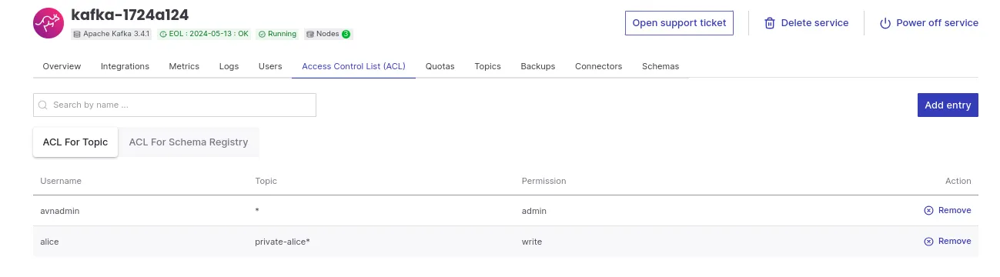
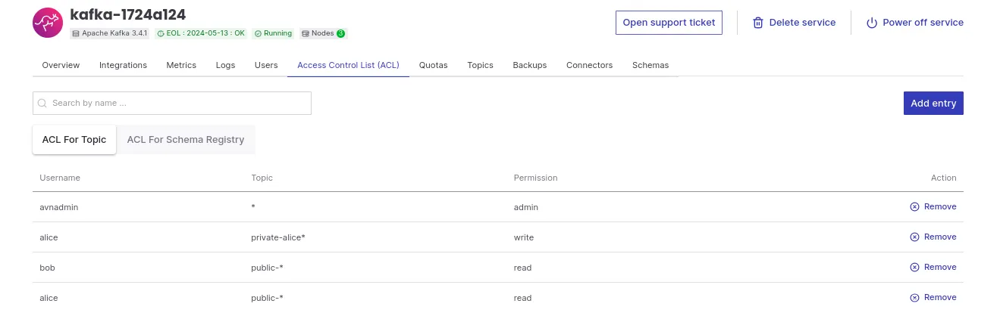

+++
author = "Florian Hussonnois"
title = "Jikkou: Declarative ACLs configuration for Apache Kafka and Schema Registry on Aiven"
date = "2023-08-02"
tags = [
    "apache kafka",
    "jikkou",
    "aiven",
    "acl",
    "schema registry",
    "gitops",
    "open source",
]
draft = false
description = "Learn how to use Jikkou to declaratively manage ACL entries for Apache Kafka topics and Schema Registry on Aiven using GitOps-style workflows."
image = "/images/posts/jikkou-aiven-acls/cover.jpg"
+++


*Photo by [iMattSmart](https://unsplash.com/@imattsmart) on [Unsplash](https://unsplash.com)*

Whether you've been running **Apache Kafka** in production for a few days or a while, you should be aware that creating and managing topics, Access Control, Schemas, etc. by hand is tedious and error-prone.

A better approach is to rely on **declarative configuration**, **revision control** and **automation** to build repeatable and traceable workflows for managing the things of your data streaming platform. In other words, [**GitOps-style**](https://github.blog/2023-06-02-applying-gitops-principles-to-your-operations/) is the way!

And of course, [**Jikkou**](https://streamthoughts.github.io/jikkou/) is one of the tools specially designed for that purpose.

> For an introduction to Jikkou, I highly recommend reading this first blog post: [**Why is Managing Kafka Topics Still Such a Pain? Introducing Jikkou!**](https://medium.com/@fhussonnois/why-is-managing-kafka-topics-still-such-a-pain-introducing-jikkou-4ee9d5df948)

The latest versions of Jikkou have introduced several new features, including support for managing Schema Registry, and Access Control for [**Aiven**](https://aiven.io/kafka) managed service for Apache Kafka.

In this short blog post, I propose to review these new features and explore how you can use them in your everyday projects.

## ACLs For Kafka Topics (Aiven)

Before Jikkou v0.24.0, it was already possible to manage the ACLs of a Kafka cluster by defining a resource of type: `kafka.jikkou.io/v1beta2:KafkaPrincipalAuhtorization`

However, it was not possible to directly manage ACLs on Kafka Cluster managed by Aiven due to some restrictions. In fact, Aiven uses custom [Authentication and Authorization Plugins for Apache Kafka](https://github.com/Aiven-Open/auth-for-apache-kafka) which, unfortunately, does not support the creation or deletion of ACL entries yet.

Since Jikkou integrates directly with the [**Aiven API**](https://api.aiven.io/doc/#tag/Service:_Kafka) to manage ACL entries for Kafka topics and Schema Registry.

So, let's have a look at these new capabilities!

### Step 1: Install and configure Jikkou CLI

First, download and install the latest release of Jikkou. For Debian, run the following commands to install the latest version:

```bash
wget https://github.com/streamthoughts/jikkou/releases/download/v0.24.0/jikkou.deb && \
sudo dpkg -i jikkou.deb && \
source <(jikkou generate-completion) && \
jikkou --version
```

*Note: You can follow the following instructions to install it from a tarball distribution ([see doc](https://streamthoughts.github.io/jikkou/docs/introduction/installation/#install-from-tarball-distribution)).*

### Step 2: Configure

To configure Jikkou CLI, let's create a new configuration context called `aiven-demo` with the following command. You will need to adapt it with your Aiven information.

```bash
$ jikkou config set-context aiven-demo \
  --config-props=aiven.project=<AIVEN_PROJECT_NAME>\
  --config-props=aiven.service=<AIVEN_SERVICE_NAME> \
  --config-props=aiven.tokenAuth=<AIVEN_AUTHENTICATION_TOKEN>

$ jikkou config use-context aiven-demo
```

*Note: If necessary, refer to [Aiven documentation](https://docs.aiven.io/docs/platform/howto/create_authentication_token) for more detail about how to create an authentication token.*

### Step 3: Managing ACLs for Kafka Topics

To check that everything works, let's first describe the existing ACL entries for our Kafka Topics using the `jikkou get avn-kafka-topic-acl` command:

If you have just created a new Kafka service, you should get a result similar to this one:

```yaml
---
apiVersion: "kafka.aiven.io/v1beta1"
kind: "KafkaTopicAclEntry"
metadata:
 labels: {}
 annotations:
   aiven.io/kafka-acl-id: "default"
spec:
 permission: "ADMIN"
 username: "avnadmin"
 topic: "*"
```

However, if you have an existing service with many ACLs, it may be preferable to use a [*selector*](https://streamthoughts.github.io/jikkou/docs/concepts/selectors/) to list only the ACL entries for a specific *username*, as follows:

```bash
jikkou get avn-kafka-topic-acl --selector 'spec.username IN (avnadmin)'
```

Next, let's create a new ACL entry by creating a file `aiven-topic-acls.yaml` with the following content:

```yaml
# ./aiven-topic-acls.yaml
---
apiVersion: "kafka.aiven.io/v1beta1"
kind: "KafkaTopicAclEntry"
spec:
 permission: "READWRITE"
 username: "alice"
 topic: "private-alice*"
```

And, run `jikkou apply -f aiven-topic-acls.yaml`. Jikkou should output the executed changes:

```text
TASK [ADD] Add Kafka ACL Entry for user 'alice' (topic=private-alice*, permission=readwrite) - CHANGED
{
  "status" : "CHANGED",
  "changed" : true,
  "failed" : false,
  "end" : 1690960004503,
  "data" : {
    "after" : {
      "permission" : "readwrite",
      "topic" : "private-alice*",
      "username" : "alice"
    },
    "operation" : "ADD"
  }
}
EXECUTION in 960ms
ok : 0, created : 1, altered : 0, deleted : 0 failed : 0
```

If we go to the [Aiven Web Console](https://console.aiven.io/), then we should see the new ACL entry.



*Aiven Web Console — ACL For Topic*

Note that when creating an ACL entry you can grant `READ`, `WRITE`, `READWRITE`, or `ADMIN` permissions to a user.

*For more detail about ACL, you can refer to the Aiven documentation at: [https://docs.aiven.io/docs/products/kafka/concepts/acl](https://docs.aiven.io/docs/products/kafka/concepts/acl)*

### Step 4: Deleting ACLs for Kafka Topics

Finally, and as with any other resources, we can remove the ACL entry, previously created, by using the specific annotation `jikkou.io/delete`:

```yaml
# ./aiven-topic-acls.yaml
---
apiVersion: "kafka.aiven.io/v1beta1"
kind: "KafkaTopicAclEntry"
metadata:
  annotations:
    jikkou.io/delete: true
spec:
 permission: "READWRITE"
 username: "alice"
 topic: "private-alice*"
```

Here, to only execute the `DELETE` change we will use the command `jikkou delete --files aiven-topic-acls.yaml` (but, we could also use `apply`).

```text
TASK [DELETE] Delete Kafka ACL Entry for user 'alice' (topic=private-alice*, permission=readwrite) - CHANGED
{
  "status" : "CHANGED",
  "changed" : true,
  "failed" : false,
  "end" : 1690960139775,
  "data" : {
    "before" : {
      "permission" : "readwrite",
      "topic" : "private-alice*",
      "username" : "alice",
      "id" : "acl44e40d03141"
    },
    "operation" : "DELETE"
  }
}
EXECUTION in 917ms
ok : 0, created : 0, altered : 0, deleted : 1 failed : 0
```

Using the `jikkou.io/delete` annotation is the safest way to remove specific ACL entries. However, using it can quickly become tedious if you manage all access to your kafka topics in a single repository.

Let's imagine we want to create a set of ACLs for all our Kafka users. For doing this, we can easily use Jikkou templating capabilities:

```yaml
# ./aiven-users.yaml
---
users:
  - username: alice
    acls:
      - spec:
        permission: "WRITE"
        topic: "private-alice*"
  - username: bob
    acls: []
```

```yaml
#./aiven-topic-acls.tpl
---
apiVersion: "kafka.aiven.io/v1beta1"
kind: "KafkaTopicAclEntry"
spec:
 permission: "ADMIN"
 username: "avnadmin"
 topic: "*"

---
apiVersion: "kafka.aiven.io/v1beta1"
kind: "KafkaTopicAclEntry"
spec:
  permission: "READ"
  username: "{{ user.username }}"
  topic: "public-*"

---
apiVersion: "kafka.aiven.io/v1beta1"
kind: "KafkaTopicAclEntry"
spec:
  permission: "{{ acl.permission }}"
  username: "{{ user.username }}"
  topic: "{{ acl.topic }}"


```

ACL entries can then be managed using the Jikkou CLI command:

```bash
$ jikkou apply \
  --files aiven-topic-acls.tpl \
  --values-files aiven-users.yaml \
  --options delete-orphans=true
```

After running this, we should see all the ACL entries created by Jikkou in the [Aiven Web Console](https://console.aiven.io/).



*Aiven Web Console — ACL For Topic*

As you can see, in the above command, we have specified the `delete-orphans=true` option. This option can be used to indicate that we want to delete all ACL entries that are not explicitly defined in the input files. Usually, this option is used only if all ACLs are managed by Jikkou. Otherwise, you could unintentionally delete ACLs created directly from the [Aiven Web Console](https://console.aiven.io/) or the [Aiven Terraform Provider](https://registry.terraform.io/providers/aiven/aiven/latest/docs).

Next, we could for example remove the user `bob` from the `aiven-users.yaml` and re-execute the `apply` command to remove any ACL entries attached to this user.

Edit the `./aiven-users.yaml` as follows:

```yaml
---
users:
  - username: alice
    acls:
      - spec:
        permission: "WRITE"
        topic: "private-alice*"
#  - username: bob
#    acls: []
```

Then, re-execute the command with the additional `--dry-run` option to make sure that only desired ACL entries will be deleted.

```bash
$ jikkou apply \
  --files aiven-topic-acls.tpl \
  --values-files aiven-users.yaml \
  --options delete-orphans=true \
  --dry-run
```

Finally, Jikkou should output the *DELETE* change for user *bob*.

```text
TASK [DELETE] Delete Kafka ACL Entry for user 'bob' (topic=public-*, permission=read) - CHANGED
{
  "status" : "CHANGED",
  "changed" : true,
  "failed" : false,
  "end" : 1690960320860,
  "data" : {
    "before" : {
      "permission" : "read",
      "topic" : "public-*",
      "username" : "bob",
      "id" : "acl44e40fdf8c4"
    },
    "operation" : "DELETE"
  }
}

# ... omitted for clarity
```

## ACLs For Schema Registry (Aiven)

Managing ACLs for Schema Registry is just as simple.

You can use the `jikkou get avn-schema-registry-acl` command to list all the ACL entries.

```yaml
---
apiVersion: "kafka.aiven.io/v1beta1"
kind: "SchemaRegistryAclEntry"
metadata:
  labels: {}
  annotations:
    kafka.aiven.io/acl-entry-id: "default-sr-admin-config"
spec:
  permission: "WRITE"
  username: "avnadmin"
  resource: "Config:"
---
apiVersion: "kafka.aiven.io/v1beta1"
kind: "SchemaRegistryAclEntry"
metadata:
  labels: {}
  annotations:
    kafka.aiven.io/acl-entry-id: "default-sr-admin-subject"
spec:
  permission: "WRITE"
  username: "avnadmin"
  resource: "Subject:*"
```

As you can see, in the example above, the resource name pattern should be `Config:` or `Subject:<schema_name_or_pattern>` depending on whether you want to grant authorization for a *Subject* or a *Config*.

In addition, only `READ` and `WRITE` permissions can be granted to users.

Creating and deleting ACL entries for the Schema Registry is similar to what we have already seen in the previous section for Kafka topics.

## Conclusion

Jikkou continues to evolve with the aim of making the configuration of a streaming platform so easy that it becomes boring. As we've just seen, Jikkou now integrates more easily with Aiven to help more Apache Kafka users. It offers a simple way to manage your ACLs, and can easily be used to set up a GitOps approach in order to automate the management of your kafka infrastructure.

If you find this project valuable, I kindly ask you to show your support by sharing this article and spreading the word. You can even show your support by giving a star on the [GitHub](https://github.com/streamthoughts/jikkou) repository.

We also welcome contributions from the community. If you have any ideas or specific project needs, please feel free to reach out and propose them. You can actively contribute to the project by creating [pull requests](https://github.com/streamthoughts/jikkou/pulls) (PR).

Thank you very much.
