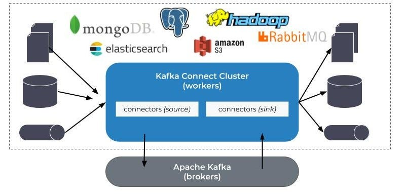

+++
author = "Florian Hussonnois"
title = "Kafka Connect FilePulse - One Connector to Ingest them All!"
date = "2020-01-24"
tags = [
    "apache kafka",
    "kafka connect",
    "open source",
    "data",
]
draft = false
image = "/images/posts/kafka-connect-filepulse/cover.jpg"
+++


*Photo by Brandon Green on [Unsplash](https://unsplash.com)*

_This blog post was originally published on [Medium](https://medium.com/streamthoughts/kafka-connect-filepulse-one-connector-to-ingest-them-all-faed018a725c)_

Most of the projects I’ve worked on in the last few years have involved ingesting data into systems such as Apache Kafka® and Apache Hadoop® to perform processing and data enrichment both in real-time and in batch.

One of the recurring challenges of each of these projects has always been to manage the complexity of legacy systems in which data was frequently exported, shared and integrated through the use of files.

I am convinced that organizations that operate today with applications that rely on export files will probably continue to do so in the future. The main reason for this is that these systems have been working perfectly well for years and there is no valuable reason (or no budget) to upgrade these systems.

However, all these organizations have to build new systems that are more agile, scalable and more responsive to provide insight in real-time. And, sooner or later these data (i.e these files) will have to be collected.

## Kafka Connect

Apache Kafka® is now a standard solution to build event-streaming platforms to centralize and distribute data across your organization in real-time.

Part of the Apache Kafka® platform, Kafka Connect provides a distributed and resilient framework to stream data between Apache Kafka and external systems (e.g. Hadoop, Cassandra, MongoDB, AWS S3, etc).



*Apache Kafka Connect — Overview*

Kafka Connect uses a concept of source connector and sink connector to do the integration job between all your systems. One of the key advantages of using Kafka Connect is that dozens of connectors are already available off-the-shelf for common systems. You can find most of the existing connectors on [Confluent Hub](https://www.confluent.io/hub/).

However, when it comes to efficiently ingest and transform data from files, it’s usually difficult to use Kafka Connect as an alternative to other solutions such as Logstash or Apache Nifi. Indeed, existing connectors often support only a limited set of functionalities or are not suitable for common use-cases (e.g collecting logs).

For example, some of the connectors:

- are not designed to be executed with multiple tasks.
- can’t be run in distributed mode.
- only supports delimited file formats.
- can’t be used to group multiplelines of text.
- can’t be extended easily.

*Note: If you want to know more about Kafka Connect and its uses, I highly recommend you to read* [*Robin Moffat*](https://twitter.com/rmoff)*’s blog posts —* [*https://rmoff.net/*](https://rmoff.net/)*.*

## Introducing Kafka Connect File Pulse

[Connect File Pulse](https://github.com/streamthoughts/kafka-connect-file-pulse) is a multi-purpose Kafka Connect plugin for ingesting and transforming files that was release in open-source a few months ago.

### Key Features

Connect File Pulse provides the capability to periodically scan an input local directory (recursively or not) for new files and read and transform data as strongly typed records. Records are sent into Apache Kafka as new files are added into the input directory or data are added to an existing file.

Let’s now describe some of the concepts of Connect File Pulse.

### Readers

Connect File Pulse supports multiple input formats via different built-in [FileInputReader](https://github.com/streamthoughts/kafka-connect-file-pulse/blob/master/connect-file-pulse-api/src/main/java/io/streamthoughts/kafka/connect/filepulse/reader/FileInputReader.java).

As of this writing, Connect File Pulse provides the following readers:

- **RowFileInputReader:** allows reading a file line by line and creates one record per row. It can be used to read, for example, delimited text files (i.e. CSV, TSV) or application log files (e.g. log4j).
- **BytesArrayInputReader:** can be used to create a single byte array record from a source file.
- **AvroFileInputReader:** allows reading input Avro container files.
- **XMLFileInputReader:** allows reading simple XML files. This reader will infer record schema from the XML DOM.

### Filters

Connect File Pulse allows you to configure complex filtering chains for parsing, transforming and enriching data through the use of [Filters](https://streamthoughts.github.io/kafka-connect-file-pulse/docs/developer-guide/filters-chain-definition/).

Here are some examples of the provided built-in Filters:

- **AppendFilter:** Appends one or more values to an existing or non-existing array field.
- **DelimitedRowFilter:** Parses a message field’s value containing columns delimited by a separator into a struct.
- **GrokFilter:** Parses an unstructured message field’s value to a struct by combining Grok patterns (similar to Logstash).
- **GroupRowFilter:** Regroups multiple following messages into a single message by composing a grouping key.
- **JSONFilter:** Unmarshallings a JSON message field’s value to a complex struct.

Filters can be compared to Kafka Connect built-in Single Message Transforms (SMT) functionality (a.k.a.[Transformers](https://kafka.apache.org/documentation/#connect_transforms)). However, filters allow more complex pipelines to be built for structuring file data. For example, filters can be used to split one input message into multiple messages or to temporarily buffer consecutive messages in order to regroup them by fields or by a pattern.

A common use-case is to leverage the *filters* to parse the log files of an application. Below is a sample configuration using the two filters: **MultiRowFilter** and **GrokFilter**.

```properties
# List of aliases for the filter chain, specifying the order in which the filters will be applied.
filters=GroupMultilineException, ParseLog4jLog

# Configuration for the filter with alias 'GroupMultilineException'
filters.GroupMultilineException.negate=false
filters.GroupMultilineException.pattern="^[\\t]"
filters.GroupMultilineException.type=io.streamthoughts.kafka.connect.filepulse.filter.MultiRowFilter

# Configuration for the filter with alias 'ParseLog4jLog'
filters.ParseLog4jLog.match="%{TIMESTAMP_ISO8601:logdate} %{LOGLEVEL:loglevel} %{GREEDYDATA:message}"
filters.ParseLog4jLog.overwrite=message    
filters.ParseLog4jLog.source=message   
filters.ParseLog4jLog.type=io.streamthoughts.kafka.connect.filepulse.filter.GrokFilter
filters.ParseLog4jLog.ignoreFailure=true
```

*Kafka Connect File Pulse — Log4J Filter Chain Example*

As you can see, in the example above, Connect File Pulse follows the same configuration style for defining filters as the one used for configuring the Transformers:

- **filters** — List of aliases for the filter chain, specifying the order in which the filters will be applied.
- **filters.$alias.type** — Fully qualified class name for the filter.
- **filters.$alias.$filterSpecificConfig —** Configuration properties for the filter

In addition, Connect File Pulse allows you to easily configure a *filter* so that it will be applied only on input records matching a specific condition.

For example, let’s say we would like to add a tag to all records containing an error message for a specific exception, then we could configured a *filter* as follows:

```properties
# The type of the filter
filters.TagSecurityException.type=io.streamthoughts.kafka.connect.filepulse.filter.AppendFilter
# The name of the field to add
filters.TagSecurityException.field=tags
# the value of the field
filters.TagSecurityException.values=SecurityAlert
# The filter condition expression (using Simple Connect Expression Language)
filters.TagSecurityException.if="{{ contains($value.logmessage, BadCredentialsException) }}"
# Invert the boolean value return from the if expression
filters.TagSecurityException.invert=false
```

*Kafka Connect File Pulse — Conditional filter*

In the example above, the `if` property accepts a simple expression. Indeed, Connect File Pulse defines a simple expression language so-called [*Simple Connect Expression Language*](https://streamthoughts.github.io/kafka-connect-file-pulse/docs/developer-guide/accessing-data-and-metadata/) (ScEL for short), which is based on regex, that allows accessing and manipulating record fields and metadata. You can use ScEL for configuring most of the built-in filters.

Finally, you can configure each filter to either ignore errors or to branch to a sub-filters-chain.

### Cleanup Policy

Connect File Pulse provides three built-in cleanup policies that can be applied once a file is successfully processed or failed:

- **DeleteCleanupPolicy:** deletes all files regardless of their final status (completed or failed).
- **LogCleanPolicy:** prints to logs information about the completed files.
- **MoveCleanupPolicy:** attempts to move atomically files to configurable target directories.

## Designed for Extensibility

From the very beginning, Connect File Pulse was designed to be easily extended. Thus, you can implement and configure custom classes for `FileInputReader`, `Filter` or `FileCleanupPolicy` interfaces.

You can even go further by implementing your own class to scan the input directory (i.e. `FSDirectoryWalker`).

## Synchronization between Connector and Tasks

Kafka Connect doesn’t provide a mechanism for synchronization of tasks and the connector instance. For this reason, Connect File Pulse uses an internal Kafka topic (default: *connect-file-pulse-status*) to track the processing progress of files and to ensure that each file is processed by a single task.

The connector instance is responsible to periodically scan the input directory. When new files are detected the connector triggers a re-configuration of tasks and each task is assigned to a set of files. While processing files, tasks send information about the current file being processed into this internal topic. Finally, the connector instance consumes this internal topic and cleanup any completed files.

This simple mechanism allows Connect File Pulse to be safely deployed in distributed mode with multiple tasks.

Moreover, you can leverage this internal topic to history metadata about the files that are processed.

## Getting Started

Now that you have a better understanding of the uses and features of Kafka Connect File pulse, I will give an example on how to read a log file.

For this example, we will parse and stream the application log file of our Connect Worker (i.e. `kafka-connect.log` ) into a Kafka topic.

### Starting Kafka Cluster using Docker

First, we need to deploy a simple Kafka platform. For doing this, you can download the `docker-compose.yml` file available on the [GitHub](https://github.com/streamthoughts/kafka-connect-file-pulse/blob/master/docker-compose.yml) repository:

```bash
$ wget https://raw.githubusercontent.com/streamthoughts/kafka-connect-file-pulse/master/docker-compose.yml
```

This `docker-compose.yml` file will run a Kafka Cluster composed of a single broker-node, a single Zookeeper node and one Schema Registry instance using the Docker images for Kafka provided by [Confluent.Inc](https://hub.docker.com/r/confluentinc/cp-kafka).

In addition, it will start a Kafka Connect worker instance with the connect-file-pulse pre-installed ([https://hub.docker.com/r/streamthoughts/kafka-connect-file-pulse](https://hub.docker.com/r/streamthoughts/kafka-connect-file-pulse)).

Note that Connect File Pulse is also available on the [Confluent-Hub](https://www.confluent.io/hub/streamthoughts/kafka-connect-file-pulse) and hence can be downloaded and installed directly using the following command:

```bash
$ confluent-hub install streamthoughts/kafka-connect-file-pulse:1.2.1
```

Then, start the contains as follows:

```bash
$ docker-compose up -d
```

Wait a few seconds for the containers start, then you can verify that connect-file-pulse is available using this command:

```bash
$ curl -sX GET http://localhost:8083/connector-plugins | grep FilePulseSourceConnector
```

### Configuring Connect File Pulse connector

Let’s create a JSON configuration file named `connect-file-pulse-quickstart-log4j.json` containing:

```json

{
  "config": {
    "connector.class": "io.streamthoughts.kafka.connect.filepulse.source.FilePulseSourceConnector",
    "filters": "GroupMultilineException, ParseLog4jLog",
    "filters.GroupMultilineException.negate": "false",
    "filters.GroupMultilineException.pattern": "^[\\t]",
    "filters.GroupMultilineException.type": "io.streamthoughts.kafka.connect.filepulse.filter.MultiRowFilter",
    "filters.ParseLog4jLog.match": "%{TIMESTAMP_ISO8601:logdate} %{LOGLEVEL:loglevel} %{GREEDYDATA:message}",
    "filters.ParseLog4jLog.overwrite": "message",
    "filters.ParseLog4jLog.source": "message",
    "filters.ParseLog4jLog.type": "io.streamthoughts.kafka.connect.filepulse.filter.GrokFilter",
    "filters.ParseLog4jLog.ignoreFailure": "true",
    "fs.cleanup.policy.class": "io.streamthoughts.kafka.connect.filepulse.clean.LogCleanupPolicy",
    "fs.scanner.class": "io.streamthoughts.kafka.connect.filepulse.scanner.local.LocalFSDirectoryWalker",
    "fs.scan.directory.path": "/var/log/kafka/",
    "fs.scan.filters": "io.streamthoughts.kafka.connect.filepulse.scanner.local.filter.RegexFileListFilter",
    "file.filter.regex.pattern": "kafka-connect\\.log$",
    "fs.scan.interval.ms": "10000",
    "internal.kafka.reporter.bootstrap.servers": "broker:29092",
    "internal.kafka.reporter.id": "connect-file-pulse-log4j-quickstart",
    "internal.kafka.reporter.topic": "connect-file-pulse-status",
    "offset.strategy": "name",
    "read.max.wait.ms": "5000",
    "task.reader.class": "io.streamthoughts.kafka.connect.filepulse.reader.RowFileInputReader",
    "topic": "logs-kafka-connect",
    "tasks.max": 1
  },
  "name": "connect-file-pulse-quickstart-log4j"
}
```

*Kafka Connect File Pulse —Connector Configuration for Log4J files*

Next, start a new connector instance by running the following:

```bash
$ curl -sX POST http://localhost:8083/connectors \
-d @connect-file-pulse-quickstart-log4j.json \
--header "Content-Type: application/json" | jq
```

You can check that the connector is running successfully with:

```bash
$ curl -sX GET http://localhost:8083/connectors/connect-file-pulse-quickstart-log4j | jq
```

### Tracking File Processing Progress

For tracking file processing progress, you can consume the internal topic used by Connect File Pulse to synchronize the tasks and the connector. Messages are serialized using JSON.

```bash
$ docker exec -it -e KAFKA_OPTS="" connect kafka-console-consumer --topic connect-file-pulse-status --from-beginning --bootstrap-server broker:29092
```

### Consuming Kafka Messages

Finally, let’s consume the output messages write into the topic `logs-kafka-server`:

```bash
$ docker exec -it -e KAFKA_OPTS="" connect kafka-avro-console-consumer --topic logs-kafka-connect \
--from-beginning --bootstrap-server broker:29092 \
--property schema.registry.url=http://schema-registry:8081
```

(output)

You should get messages in the form of:

```text
{“logdate”:{“string”:”2020–01–22 18:14:36,648"},”loglevel”:{“string”:”INFO”},”message”:{“string”:”[pool-15-thread-3] Finished initializing local filesystem scanner (io.streamthoughts.kafka.connect.filepulse.scanner.LocalFileSystemScanner)”}}
{“logdate”:{“string”:”2020–01–22 18:14:36,649"},”loglevel”:{“string”:”INFO”},”message”:{“string”:”[FileSystemMonitorThread] Starting thread monitoring filesystem. (io.streamthoughts.kafka.connect.filepulse.source.FileSystemMonitorThread)”}}
{“logdate”:{“string”:”2020–01–22 18:14:36,649"},”loglevel”:{“string”:”INFO”},”message”:{“string”:”[FileSystemMonitorThread] Scanning local file system directory ‘/var/log/kafka/’ (io.streamthoughts.kafka.connect.filepulse.scanner.LocalFileSystemScanner)”}}
{“logdate”:{“string”:”2020–01–22 18:14:36,650"},”loglevel”:{“string”:”INFO”},”message”:{“string”:”[pool-15-thread-3] Finished creating connector connect-file-pulse-quickstart-log4j (org.apache.kafka.connect.runtime.Worker)”}}
```

Stop all the containers:

```bash
$ docker-compose down
```

## Comparing Connect File Pulse with other Connectors

Here is a simple comparaison between Connect File Pulse and other solutions: [Connect Spooldir](https://github.com/jcustenborder/kafka-connect-spooldir) and [Connect FileStreams](https://github.com/apache/kafka/tree/trunk/connect/file).

|                                             |Connect FilePulse  | Connect Spooldir | Connect FileStreams |
|:---                                         |            :---:   |  :---:           |   :---:              |
| **Connector Type**                          | source             | source           | source / sink        |
| **License**                                 |Apache License 2.0  |Apache License 2.0| Apache License 2.0   |
| **Available on Confluent Hub**              | YES                | YES              | YES                  |
| **Docker image**                            | YES                | NO               | NO                   |
| **Delivery semantics**                      | At-least-once      | At-least-once    | At-most-once         |
| **Usable in production**                    | YES                | YES              | NO                   |
| **Supported file formats(out-of-the box)**  | Delimited, Binary, JSON, Avro, XML (limited) | Delimited, JSON | Text file                |
| **Source partitions** | Configurable (filename, path, filename+hash) | filename | filename |
| **Support for distributed mode (multi-tasks)**  | YES (requires a shared volume) | NO | NO |
| **Support for streaming log files** | YES | NO | YES |
| **Support for transformation** | Single Message Transforms, Filters (Grok, Append, JSON, etc) |Single Message Transforms| Single Message Transforms
| **Support for tracking processing progress of files**              | YES (using an internal topic)               | NO               | NO                   |

*Connect File Pulse vs Connect Spooldir vs Connect FileStreams*

## Conclusion

Kafka Connect File Pulse is a new connector that can be used to easily ingest local file data into Apache Kafka. Connect File Pulse offers the capability to define complex pipelines to transform data using a rich collection of built-in filters. Last but not least, it defines several pluggable interfaces that can be implemented to fit your project context.

## About Us:

[StreamThoughts](https://www.streamthoughts.io/) is an open source technology consulting company. Our mission is to inspire companies to create ever more innovative services that make the most of the opportunities offered by real-time data streaming.

We deliver high-quality professional [services](https://www.streamthoughts.io/services/apache-kafka/) and [training](https://www.streamthoughts.io/training/), in France, on the Apache Kafka ecosystem and Confluent.Inc Streaming platform.
