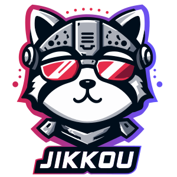
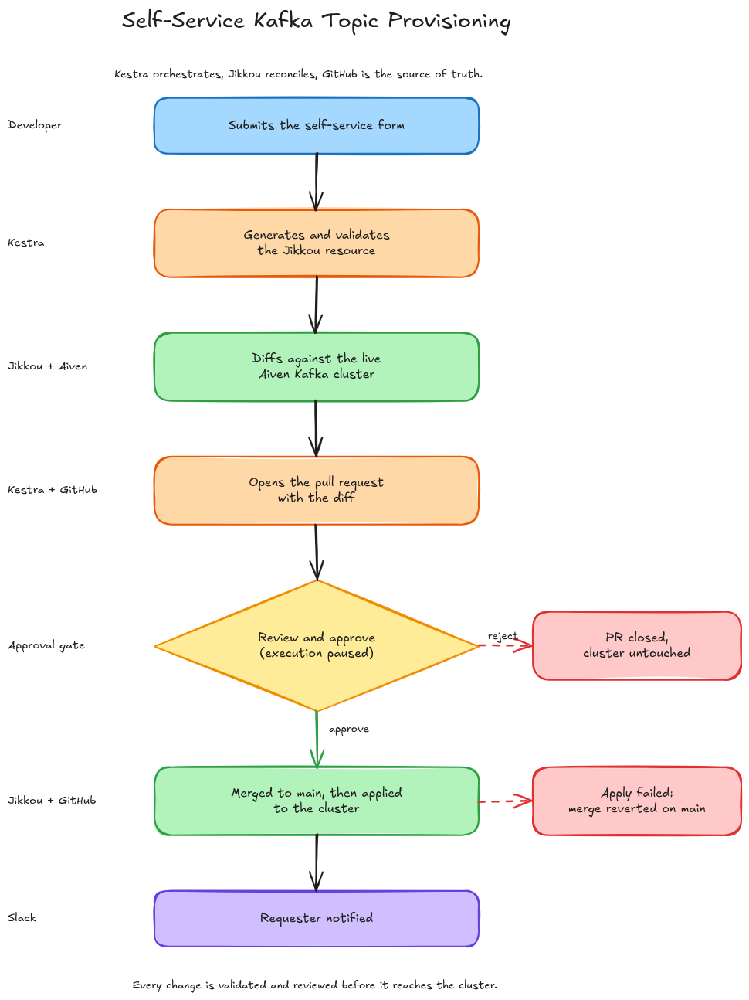
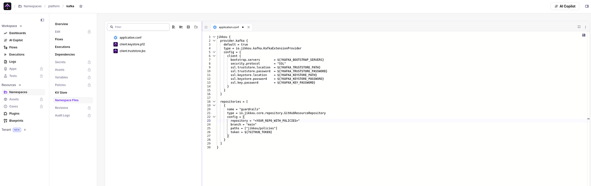
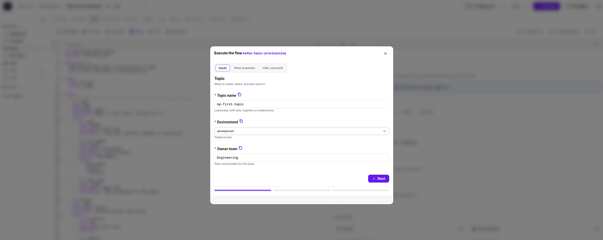
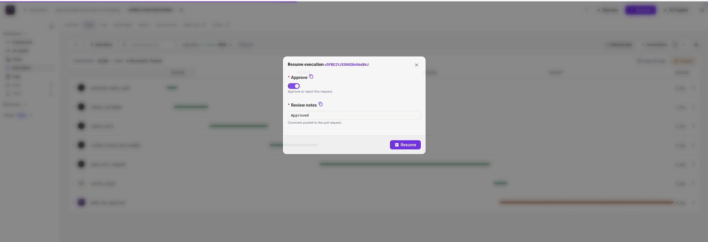
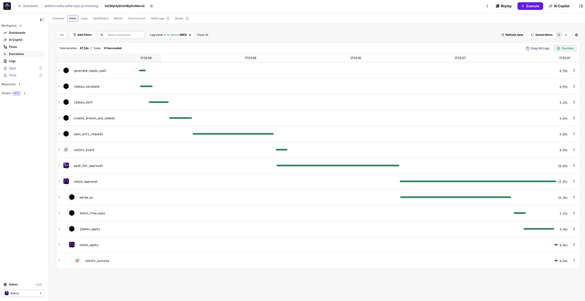

+++
author = "Florian Hussonnois"
title = "Kafka Topic as a Service: Automating GitOps Workflows with Kestra and Jikkou"
date = "2026-09-21"
tags = [
    "apache kafka",
    "kestra",
    "jikkou",
    "gitops",
    "aiven",
    "orchestration",
]
draft = false
description = "From manual CLI commands to a fully automated, human-in-the-loop provisioning service with Kestra and Jikkou on Aiven’s free Kafka tier."
image = "/images/posts/kafka-topic-as-a-service/cover.jpg"
+++


*Photo by Barrington Ratliff on [Unsplash](https://unsplash.com)*

_This blog post was originally published on [Medium](https://medium.com/@fhussonnois/kafka-topic-as-a-service-automating-gitops-workflows-with-kestra-and-jikkou-f9eff8633a86)_

*From manual CLI commands to a fully automated, human-in-the-loop provisioning service with Kestra and Jikkou on Aiven’s free Kafka tier.*

Managing Apache Kafka resources at scale is one of those problems that starts simple and quickly becomes painful. One day you’re running `kafka-topic.sh` from your terminal, and the next you’re the gatekeeper for dozens of teams who all need topics, ACLs, and connectors, and of course they needed them yesterday.

Over the years of working with Kafka, I’ve seen this pattern repeat itself: a centralized Ops team becomes a bottleneck, Jira tickets or Github issues pile up, and developers grow frustrated waiting for resources that should take seconds to provision.

And the worst part of it all is that we all know the root cause: **no automation**, **no standardization**.

And let’s be honest, even if you’ve implemented [Terraform](https://developer.hashicorp.com/terraform), it’s likely that a single team is managing the `apply`, struggling every day to manage stale plans. And here you are missing the final problem: you miss **the self-service**.

In this post, I’m going to show you one way to solve that, but the same approach could be used for ACLs, Schema management, or probably for anything else.

For this, I’m going to combine two tools I work on: [**Jikkou**](https://www.jikkou.io/) (an open-source Resource-as-Code framework for Apache Kafka) and [**Kestra**](https://kestra.io/) (the orchestration and automation platform I work on as Lead Software Engineer). Together, they form the foundation for our Kafka Topic as a Service, complete with GitOps, diff previews, human approval, and a polished self-service UI.

We’ll build everything on Aiven’s free Kafka tier, so you can follow along without standing up your own cluster.

## Why CLIs and Scripts Aren’t Enough

I’m sure you already have the answer, but let’s be concrete about what breaks down. It starts with one topic:

```bash
kafka-topics.sh --bootstrap-server localhost:9092 \
  --create --topic my-orders-topic \
  --partitions 6 \
  --replication-factor 3
```

But six months later someone asks: “*How many partitions does my-orders-topic have, and who set it up?*” Nobody knows. You have **no history, and no audit logs.** Just a Slack message from this summer that you’ve probably already lost, since you haven’t signed up for any Slack subscriptions 😉

Then come the config changes, and the real danger:

```bash
kafka-configs.sh --bootstrap-server localhost:9092 \
  --entity-type topics --entity-name my-orders-topic \
  --alter --add-config retention.ms=17280000
```

Oops, one misplaced zero in `retention.ms`, and you’re explaining to your team why they lost two days of data (true story, I know teams to whom this has happened 🫠).

Add a second and a third environment, and you can’t reproducibly replay what you did in dev into prod. Every environment drifts and you’re flying blind.

This is precisely the problem **GitOps** was designed to solve.

## Introducing Jikkou



[Jikkou](https://www.jikkou.io/) (実行 — Japanese for “execution, carrying out a plan”) is a project I started to bring a proper Resource-as-Code approach to Apache Kafka. It’s open source, Apache 2.0-licensed, written in Java, and available as a native binary built with GraalVM.

The core idea is simple: instead of running imperative CLI commands, you declare the desired state of your Kafka resources in YAML using the same resource model as Kubernetes, so it feels immediately familiar:

```yaml
# topics/my-orders-topic.yaml
apiVersion: "kafka.jikkou.io/v1"
kind: KafkaTopic
metadata:
  name: 'my-orders-topic'
  labels:
    environment: production
    managed-by: jikkou
spec:
  partitions: 6
  replicas: 3
  configs:
    min.insync.replicas: 2
    retention.ms: 172800000
    cleanup.policy: 'delete'
```

Jikkou then connects to your Kafka cluster, reads its actual state, computes a diff, and applies only what needs to change.

> No state file to manage. **Kafka itself is the source of truth**.

A few things that make it truly useful beyond the basics:

**Diff before you apply.** Run `jikkou diff` to see exactly what will change before touching anything in production. The output is structured and machine-readable (JSON or YAML), which makes it easy to feed into CI pipelines, approval workflows, or AI Agents.

**Resource policies for guardrails.** You can define governance rules as standalone YAML resources using [Google’s Common Expression Language](https://cel.dev/) (CEL) to enforce naming conventions, partition bounds, replication requirements, and more. Policies are versioned in Git alongside your topic definitions.

**Templating.** Jikkou supports [Jinja-style](https://jinja.palletsprojects.com/en/stable/) templating (via Jinjava) for generating multiple resources from a single template and a values file. This is really useful when you need the same topic structure across many environments or regions.

**Stateless and portable.** No daemon, no operator, no Kubernetes required. Run it anywhere Java runs, use it in a GitHub Action, AI Agent Skill, or use the native binary directly.

Install via [SDKMAN](https://sdkman.io/): `sdk install jikkou`

## Introducing Kestra


**Kestra** is an open-source, declarative workflow orchestration platform. Everything is defined in YAML. Kestra handles scheduling, retries, error handling, secrets management, and has a rich plugin ecosystem: GitHub, HTTP, Slack, databases, cloud providers, and more: [https://kestra.io/plugins](https://kestra.io/plugins)

For our use case, Kestra is the orchestration layer that ties everything together: it accepts user inputs, generates the Jikkou YAML, runs the diff, sends a notification for review, pauses for human approval, applies the change, and merges the PR. And of course, everything is done in a single auditable and versioned execution.

The feature we’ll lean on most is **Pause/Resume**: a workflow can halt mid-execution and wait for minutes, hours, or days until a human explicitly resumes it. The entire execution state is preserved. This is the backbone of a proper human-in-the-loop approval gate, with no custom webhook plumbing needed.

## What We’re Building

Here’s our full “Self-Service Kafka Topic Provisioning” workflow, end to end:



## Setup: Prerequisites

To follow along you’ll need:

- A [**Free Aiven**](https://aiven.io/free-kafka) account at [aiven.io](https://aiven.io/) with a running Kafka service.
- A **Kestra instance (v2.0.x)** — [Docker Compose](https://kestra.io/docs/installation/docker-compose) is the fastest path (see instructions below)
- A GitHub repository to store your Jikkou resource files
- A Slack webhook URL to send notifications.

No Jikkou installation is required here. Kestra will run Jikkou as a Docker container via its Docker task runner. The `streamthoughts/jikkou:latest` image will be pulled automatically the first time a flow executes.

> Note: Files and resources used in this blog post are available on this GitHub Repository: [https://github.com/fhussonnois/orchestrating-streams/tree/main/jikkou](https://github.com/fhussonnois/orchestrating-streams/tree/main/jikkou)

## Step 1: Configure Jikkou for Aiven Kafka

### Connect to Aiven Kafka

First, from your Aiven Kafka service **Overview** page, download the SSL credentials (CA cert, client cert, client key) and note your bootstrap server address (*host*). Aiven uses mutual TLS so you’ll need all of these to configure Jikkou.

1. Log in to [Aiven Console](https://console.aiven.io/) and select your Apache Kafka service.
2. Download the **Access Key**, **Access Certificate**, and **CA Certificate**. The files *service.key*, *service.cert*, and *ca.pem* are necessary.
3. Create the **keystore** and **truststore**: (see: [Configure Java SSL keystore and truststore to access Apache Kafka®](https://aiven.io/docs/products/kafka/howto/keystore-truststore#access-service-certificates))
4. Copy `client.keystore.p12` and `client.truststore.jks` file in a `certs` folder alongside your project, and set the permissions: `chmod 644 certs/client.keystore.p12 certs/client.truststore.jks`

### Configure Jikkou

Create the Jikkou configuration file `jikkou.json`:

```json
{
  "currentContext" : "aiven",
  "aiven" : {
    "configFile" : "/app/application.conf"
  }
}
```

Then, create an `application.conf` that reads connection details from environment variables. We will inject these later as Kestra secrets:

```hocon
jikkou {
  provider.kafka {
    default = true
    type = io.jikkou.kafka.KafkaExtensionProvider
    config = {
      client {
        bootstrap.servers        = ${?KAFKA_BOOTSTRAP_SERVERS}
        security.protocol        = "SSL"
        ssl.truststore.location  = ${?KAFKA_TRUSTSTORE_PATH}
        ssl.truststore.password  = ${?KAFKA_TRUSTSTORE_PASSWORD}
        ssl.keystore.location    = ${?KAFKA_KEYSTORE_PATH}
        ssl.keystore.password    = ${?KAFKA_KEYSTORE_PASSWORD}
        ssl.key.password         = ${?KAFKA_KEY_PASSWORD}
      }
    }
  }
}
```

### Test Connection

Now, you can verify the connection using the Jikkou Docker image directly. Make sure to replace the below env variables values with yours.

```bash
docker run --rm \
  -v "$(pwd)/jikkou.json:/etc/jikkou/config" \
  -v "$(pwd)/application.conf:/app/application.conf" \
  -v "$(pwd)/certs:/certs" \
  -e KAFKA_BOOTSTRAP_SERVERS="<your-aiven-host:12345>" \
  -e KAFKA_TRUSTSTORE_PATH="/certs/client.truststore.jks" \
  -e KAFKA_TRUSTSTORE_PASSWORD="changeit" \
  -e KAFKA_KEYSTORE_PATH="/certs/client.keystore.p12" \
  -e KAFKA_KEYSTORE_PASSWORD="changeit" \
  -e KAFKA_KEY_PASSWORD="changeit" \
  streamthoughts/jikkou:latest \
  health get kafka
```

You should get an output similar to:

```yaml
---
apiVersion: "core.jikkou.io/v1"
kind: "ApiHealthResult"
name: "kafka"
status:
  name: "UP"
details:
  resource: "urn:kafka:cluster:id:<cluster_id>"
  brokers:
  - id: "1"
    host: "<ip_broker_1>"
    port: 12345
  - id: "2"
    host: "<ip_broker_2>"
    port: 12345
```

### Start Kestra

First, create a `.env` file with your secrets. Kestra expects secret keys prefixed with `SECRET_` and values base64-encoded (see [official doc](https://kestra.io/docs/how-to-guides/secrets#using-secrets-in-kestra)):

```bash
# .env (plain text - do not commit this file)
GITHUB_TOKEN=ghp_your_github_token
GITHUB_REPO=your_org/your_repository
SLACK_WEBHOOK_URL=https://hooks.slack.com/services/xxx/yyy/zzz
KAFKA_BOOTSTRAP_SERVERS=your-aiven-host:12345
KAFKA_TRUSTSTORE_PATH=/certs/client.truststore.jks
KAFKA_TRUSTSTORE_PASSWORD=changeit
KAFKA_KEYSTORE_PATH=/certs/client.keystore.p12
KAFKA_KEY_PASSWORD=changeit
```

Then, use the following script to encode it into the format Kestra expects:

```bash
while IFS='=' read -r key value; do
  echo "SECRET_$key=$(echo -n "$value" | base64 -w 0)"
done < .env > .env_encoded
```

Now save the following `docker-compose.yml` and run `docker compose -f docker-compose.yml up -d`

```yaml
volumes:
  postgres-data:
    driver: local
  kestra-data:
    driver: local

services:
  postgres:
    image: postgres
    volumes:
      - postgres-data:/var/lib/postgresql/data
    environment:
      POSTGRES_DB: kestra
      POSTGRES_USER: kestra
      POSTGRES_PASSWORD: k3str4
    healthcheck:
      test: ["CMD-SHELL", "pg_isready -d $${POSTGRES_DB} -U $${POSTGRES_USER}"]
      interval: 30s
      timeout: 10s
      retries: 10

  kestra:
    image: kestra/kestra:latest
    pull_policy: if_not_present
    user: "root"
    command: server standalone
    volumes:
      - kestra-data:/app/storage
      # The Docker socket mount is what allows Kestra to spin up
      # task runner containers - for Jikkou, for alpine/git, for gh CLI
      # without installing any of those tools on the host.
      - /var/run/docker.sock:/var/run/docker.sock
      - /tmp/kestra-wd:/tmp/kestra-wd
    env_file:
      - .env_encoded
    environment:
      KESTRA_CONFIGURATION: |
        datasources:
          postgres:
            url: jdbc:postgresql://postgres:5432/kestra
            driverClassName: org.postgresql.Driver
            username: kestra
            password: k3str4
        kestra:
          repository:
            type: postgres
          storage:
            type: local
            local:
              basePath: "/app/storage"
          queue:
            type: postgres
          tasks:
            tmpDir:
              path: /tmp/kestra-wd/tmp
          url: http://localhost:8080/
          tutorial-flows:
            enabled: false
    ports:
      - "8080:8080"
      - "8081:8081"
    depends_on:
      postgres:
        condition: service_healthy
```

Open [http://localhost:8080](http://localhost:8080/) to verify Kestra is running.

## Step 2: Define Guardrails with Jikkou Resource Policies

Connecting Jikkou to your cluster is only half the story. You also need guardrails, i.e., rules that prevent bad configurations from reaching Kafka in the first place.

Jikkou handles this with [**ValidatingResourcePolicy**](https://www.jikkou.io/docs/how-to-guides/enforce-policies/): standalone YAML resources, versioned in Git alongside your topic definitions, reusable across teams, and written using [Google’s Common Expression Language](https://cel.dev/) (CEL). If you’ve used Kubernetes ValidatingAdmissionPolicies, this will feel immediately familiar.

Here’s the policy file we’ll use for this project:

```yaml
# policies/kafka-topic-policy.yaml
apiVersion: core.jikkou.io/v1
kind: ValidatingResourcePolicy
metadata:
  name: kafka-topic-guardrails
spec:
  failurePolicy: FAIL
  selector:
    matchResources:
      - kind: KafkaTopic
  rules:
    - name: TopicNameMustBeLowercase
      expression: "resource.metadata.name.matches('^[a-z0-9]+(-[a-z0-9]+)*$')"
      messageExpression: "'Topic name must be kebab-case (lowercase alphanumerics and dashes), but was: ' + resource.metadata.name"

    - name: PartitionsMustBeAtMostTwo
      expression: "resource.spec.partitions <= 2"
      messageExpression: "'Partition count must be <= 2, got: ' + string(resource.spec.partitions)"

    - name: ReplicationFactorMustBeSet
      expression: "has(resource.spec.replicas)"
      message: "Topic must explicitly declare spec.replicas"

    - name: ReplicationFactorMustBeAtMostTwo
      expression: "!has(resource.spec.replicas) || resource.spec.replicas <= 2"
      messageExpression: "'Topic replication factor must be <= 2, but was: ' + string(resource.spec.replicas)"

    - name: RetentionWithinBounds
      expression: >
        !has(resource.spec.configs) ||
        !('retention.ms' in resource.spec.configs) ||
        (int(resource.spec.configs['retention.ms']) >= 3600000 &&
         int(resource.spec.configs['retention.ms']) <= 604800000)
      message: "retention.ms must be between 1 hour and 7 days"
```

*Note: Aiven’s free Kafka tier limits topics to a maximum of 2 partitions with a replication factor of 2.*

And, a second policy to prevent accidental topic deletions:

```yaml
# policies/no-topic-deletion.yaml
apiVersion: core.jikkou.io/v1
kind: ValidatingResourcePolicy
metadata:
  name: prevent-topic-deletion
spec:
  failurePolicy: FILTER
  selector:
    matchResources:
      - kind: KafkaTopicChange
  rules:
    - name: FilterDeleteOperation
      expression: "resource.spec.op == 'DELETE'"
      messageExpression: "'DELETE operations on topics are not authorized'"
```

Notice the `failurePolicy: FILTER` so instead of failing the entire reconciliation, Jikkou silently drops the delete operation and logs a warning.

## Load policies from a repository

To make Jikkou pick up these policies automatically, add a `repositories` block to your `application.conf`:

```hocon
jikkou {
  # ... provider config from Step 1 ...

  repositories = [
    {
      name = "guardrails"
      type = io.jikkou.core.repository.GitHubResourceRepository
      config = {
        repository = "your-org/kafka-platform"
        branch = "main"
        paths = ["jikkou/policies"]
        token = ${?GITHUB_TOKEN}
      }
    }
  ]
}
```

Now your guardrails are versioned, reviewable, and shared across every environment. Change a policy, open a PR, merge it and every subsequent `jikkou diff` or `jikkou apply` picks up the new rules automatically 💪.

## Step 3: Build the Kestra Flow

This is where everything comes together.

The Kestra flow below implements the full provisioning workflow described above (see: [kafka-topic-provisioning.yaml](https://github.com/fhussonnois/orchestrating-streams/blob/main/jikkou/flows/kafka-topic-provisioning.yaml)). First, let’s create it into Kestra:

````yaml
id: kafka-topic-provisioning
namespace: platform.kafka

description: |
  Self-service Kafka topic provisioning with GitOps, 
  diff preview, and human-in-the-loop approval.

labels:
  team: platform
  service: kafka

inputs:
  - id: topic
    type: FORM
    displayName: Topic
    description: What to create, where, and who owns it.
    inputs:
      - id: name
        type: STRING
        displayName: Topic name
        description: "Lowercase, with dots, hyphens or underscores."

      - id: environment
        type: SELECT
        displayName: Environment
        description: "Target cluster."
        defaults: development
        values:
          - development
          - staging
          - production

      - id: owner_team
        type: STRING
        displayName: Owner team
        description: "Team accountable for this topic."

  - id: sizing
    type: FORM
    displayName: Sizing
    description: Partitioning and replication.
    inputs:
      - id: partitions
        type: INT
        displayName: Partitions
        defaults: 2

      - id: replicas
        type: INT
        displayName: Replication factor
        defaults: 2

  - id: retention
    type: FORM
    displayName: Retention
    description: How long records are kept, and how they age out.
    inputs:
      - id: retention_ms
        type: INT
        displayName: Retention (ms)
        description: "1 hour to 7 days."
        defaults: 172800000

      - id: cleanup_policy
        type: SELECT
        displayName: Cleanup policy
        description: "Delete old records, compact by key, or both."
        defaults: delete
        values:
          - delete
          - compact
          - compact,delete

tasks:
  # ── 1. Generate the Jikkou topic YAML ──────────────────────────
  - id: generate_topic_yaml
    type: io.kestra.plugin.scripts.shell.Script
    description: "Generate the Jikkou KafkaTopic resource file"
    script: |
        cat > topic.yaml <<'EOF'
        apiVersion: "kafka.jikkou.io/v1"
        kind: KafkaTopic
        metadata:
          name: '{{ inputs.topic.name }}'
          labels:
            environment: '{{ inputs.topic.environment }}'
            owner: '{{ inputs.topic.owner_team }}'
            managed-by: kestra
            execution-id: '{{ execution.id }}'
        spec:
          partitions: {{ inputs.sizing.partitions }}
          replicas: {{ inputs.sizing.replicas }}
          configs:
            retention.ms: {{ inputs.retention.retention_ms }}
            cleanup.policy: '{{ inputs.retention.cleanup_policy }}'
        EOF
        cat topic.yaml
    outputFiles:
      - topic.yaml

  # ── 2. Validate the resource before touching GitHub ────────────
  - id: jikkou_validate
    type: io.kestra.plugin.scripts.shell.Script
    description: "Validate the topic definition before any git work"
    containerImage: streamthoughts/jikkou:latest
    taskRunner:
      type: io.kestra.plugin.scripts.runner.docker.Docker
      pullPolicy: ALWAYS
      user: root
    env:
      KAFKA_BOOTSTRAP_SERVERS: "{{ secret('KAFKA_BOOTSTRAP_SERVERS')}}"
      KAFKA_TRUSTSTORE_PATH: "client.truststore.jks"
      KAFKA_TRUSTSTORE_PASSWORD: "{{ secret('KAFKA_TRUSTSTORE_PASSWORD') }}"
      KAFKA_KEYSTORE_PATH: "client.keystore.p12"
      KAFKA_KEYSTORE_PASSWORD: "{{ secret('KAFKA_KEYSTORE_PASSWORD') }}"
      KAFKA_KEY_PASSWORD: "{{ secret('KAFKA_KEY_PASSWORD') }}"
      JIKKOUCONFIG: .jikkou/config.json
    namespaceFiles:
      enabled: true
    inputFiles:
      topic.yaml: "{{ outputs.generate_topic_yaml.outputFiles['topic.yaml'] }}"
    script: |
        jikkou config set-context aiven --config-file application.conf
        jikkou config use-context aiven

        jikkou validate --files topic.yaml --output YAML

  # ── 3. Run Jikkou diff against the live cluster ────────────────
  - id: jikkou_diff
    type: io.kestra.plugin.scripts.shell.Script
    description: "Compute diff between desired state and live Kafka cluster"
    containerImage: streamthoughts/jikkou:latest
    taskRunner:
      type: io.kestra.plugin.scripts.runner.docker.Docker
      user: root
      pullPolicy: ALWAYS
    env:
      KAFKA_BOOTSTRAP_SERVERS: "{{ secret('KAFKA_BOOTSTRAP_SERVERS')}}"
      KAFKA_TRUSTSTORE_PATH: "client.truststore.jks"
      KAFKA_TRUSTSTORE_PASSWORD: "{{ secret('KAFKA_TRUSTSTORE_PASSWORD') }}"
      KAFKA_KEYSTORE_PATH: "client.keystore.p12"
      KAFKA_KEYSTORE_PASSWORD: "{{ secret('KAFKA_KEYSTORE_PASSWORD') }}"
      KAFKA_KEY_PASSWORD: "{{ secret('KAFKA_KEY_PASSWORD') }}"
      JIKKOUCONFIG: .jikkou/config.json
    namespaceFiles:
      enabled: true
    inputFiles:
      topic.yaml: "{{ outputs.generate_topic_yaml.outputFiles['topic.yaml'] }}"
    script: |
        jikkou config set-context aiven --config-file application.conf
        jikkou config use-context aiven

        # Run diff and capture the output
        jikkou diff \
          --files topic.yaml \
          --output json > diff_result.json 2>&1 || true

        cat diff_result.json

        # Surface diff as a Kestra output
        DIFF_CONTENT=$(cat diff_result.json)
        echo '::{"outputs":{"diff_result":"${DIFF_CONTENT}"}}::'
    outputFiles:
      - diff_result.json

  # ── 4. Commit to a feature branch on GitHub ────────────────────
  - id: create_branch_and_commit
    type: io.kestra.plugin.scripts.shell.Commands
    description: "Push the topic YAML to a feature branch"
    containerImage: alpine/git:latest
    taskRunner:
      type: io.kestra.plugin.scripts.runner.docker.Docker
    env:
      GITHUB_TOKEN: "{{ secret('GITHUB_TOKEN') }}"
      GITHUB_REPO: "{{ secret('GITHUB_REPO') }}"
    inputFiles:
      topic.yaml: "{{ outputs.generate_topic_yaml.outputFiles['topic.yaml'] }}"
    commands:
      - |
        BRANCH="topic/{{ inputs.topic.name }}-{{ execution.id }}"
        REPO_URL="https://${GITHUB_TOKEN}@github.com/${GITHUB_REPO}.git"

        git clone --depth 1 "$REPO_URL" repo
        cd repo
        git checkout -b "$BRANCH"

        mkdir -p topics/{{ inputs.topic.environment }}
        cp ../topic.yaml "topics/{{ inputs.topic.environment }}/{{ inputs.topic.name }}.yaml"

        git config user.email "kestra@your-org.com"
        git config user.name "Kestra Bot"
        git add .
        git commit -m "feat(kafka): request topic {{ inputs.topic.name }} [{{ inputs.topic.environment }}]

        Requested by: {{ inputs.topic.owner_team }}
        Execution: {{ execution.id }}
        Partitions: {{ inputs.sizing.partitions }}
        Replicas: {{ inputs.sizing.replicas }}
        Retention: {{ inputs.retention.retention_ms }}ms"

        git push origin "$BRANCH"

        echo '::{"outputs":{"branch":"'"$BRANCH"'"}}::'

  # ── 5. Open the pull request (BEFORE anyone is asked to approve) ─
  - id: open_pull_request
    type: io.kestra.plugin.scripts.shell.Commands
    description: "Open the PR carrying the topic request and its diff"
    containerImage: alpine:latest
    taskRunner:
      type: io.kestra.plugin.scripts.runner.docker.Docker
    env:
      GH_TOKEN: "{{ secret('GITHUB_TOKEN') }}"
      GH_REPO: "{{ secret('GITHUB_REPO') }}"
    inputFiles:
      diff_result.json: "{{ outputs.jikkou_diff.outputFiles['diff_result.json'] }}"
    commands:
      - |
        # gh is not in the base image; github-cli lives in Alpine community.
        apk add --no-cache github-cli > /dev/null

        BRANCH="{{ outputs.create_branch_and_commit.vars.branch }}"

        # PR body is just the Jikkou diff (capped: GitHub rejects bodies
        # over 65536 characters).
        {
          echo '```json'
          head -c 60000 diff_result.json
          echo '```'
        } > pr-body.md

        PR_URL=$(gh pr create \
          --repo "$GH_REPO" \
          --head "$BRANCH" \
          --base main \
          --title "feat(kafka): provision {{ inputs.topic.name }} [{{ inputs.topic.environment }}]" \
          --body-file pr-body.md)

        echo "Pull request opened: $PR_URL"
        echo "::{\"outputs\":{\"pr_url\":\"${PR_URL}\"}}::"

  # ── 6. Ask the platform team to review and approve ─────────────
  - id: notify_slack
    type: io.kestra.plugin.slack.notifications.SlackIncomingWebhook
    description: "Ask for review, linking the PR and the approval page"
    url: "{{ secret('SLACK_WEBHOOK_URL') }}"
    payload: |
      {
        "text": ":kafka: *Topic Provisioning Request*\n\n*Topic:* `{{ inputs.topic.name }}`\n*Environment:* `{{ inputs.topic.environment }}`\n*Requested by:* {{ inputs.topic.owner_team }}\n*Partitions:* {{ inputs.sizing.partitions }} | *Replicas:* {{ inputs.sizing.replicas }}\n*Retention:* {{ inputs.retention.retention_ms }}ms\n*Cleanup:* {{ inputs.retention.cleanup_policy }}\n\n:memo: <{{ outputs.open_pull_request.vars.pr_url }}|Review the pull request> - resource + Jikkou diff\n:white_check_mark: <{{ kestra.url }}ui/executions/{{ flow.namespace }}/{{ flow.id }}/{{ execution.id }}|Approve or reject in Kestra>"
      }

  # ── 7. Pause for human approval ────────────────────────────────
  - id: wait_for_approval
    type: io.kestra.plugin.core.flow.Pause
    description: "Wait for a platform engineer to approve or reject"
    onResume:
      - id: approved
        type: BOOL
        displayName: Approve
        description: "Approve or reject this request."
        defaults: true
      - id: review_notes
        type: STRING
        displayName: Review notes
        description: "Comment posted to the pull request."
        defaults: "Approved"

  # ── 8. Check approval decision ─────────────────────────────────
  - id: check_approval
    type: io.kestra.plugin.core.flow.If
    condition: "{{ outputs.wait_for_approval.onResume.approved }}"
    then:
      # ── 8a. Merge the approved PR into main ────────────────────
      - id: merge_pr
        type: io.kestra.plugin.scripts.shell.Commands
        description: "Merge the approved pull request"
        containerImage: alpine:latest
        taskRunner:
          type: io.kestra.plugin.scripts.runner.docker.Docker
        env:
          GH_TOKEN: "{{ secret('GITHUB_TOKEN') }}"
          GH_REPO: "{{ secret('GITHUB_REPO') }}"
        commands:
          - |
            # gh is not in the base image; github-cli lives in Alpine community.
            apk add --no-cache github-cli > /dev/null

            BRANCH="{{ outputs.create_branch_and_commit.vars.branch }}"

            gh pr comment "$BRANCH" \
              --repo "$GH_REPO" \
              --body "Approved in Kestra execution {{ execution.id }}: {{ outputs.wait_for_approval.onResume.review_notes }}"

            gh pr merge "$BRANCH" \
              --repo "$GH_REPO" \
              --squash \
              --delete-branch

            # The squash commit now on main. Captured by PR url rather than by
            # branch, because --delete-branch just removed the branch ref.
            MERGE_SHA=$(gh pr view "{{ outputs.open_pull_request.vars.pr_url }}" \
              --json mergeCommit --jq .mergeCommit.oid)

            echo "Merged main as $MERGE_SHA"
            echo "::{\"outputs\":{\"merge_sha\":\"${MERGE_SHA}\"}}::"

      # ── 8b. Read the definition back from main ─────────────────
      - id: fetch_from_main
        type: io.kestra.plugin.scripts.shell.Commands
        description: "Fetch the merged topic definition from main"
        containerImage: alpine/git:latest
        taskRunner:
          type: io.kestra.plugin.scripts.runner.docker.Docker
        env:
          GITHUB_TOKEN: "{{ secret('GITHUB_TOKEN') }}"
          GITHUB_REPO: "{{ secret('GITHUB_REPO') }}"
        commands:
          - |
            git clone --depth 1 --branch main https://${GITHUB_TOKEN}@github.com/${GITHUB_REPO}.git" repo

            cp "repo/topics/{{ inputs.topic.environment }}/{{ inputs.topic.name }}.yaml" topic.yaml
            cat topic.yaml
        outputFiles:
          - topic.yaml

      # ── 8c. Reconcile the cluster from what main now holds ─────
      - id: jikkou_apply
        type: io.kestra.plugin.scripts.shell.Commands
        description: "Apply the merged topic definition to the Kafka cluster"
        containerImage: streamthoughts/jikkou:latest
        taskRunner:
          type: io.kestra.plugin.scripts.runner.docker.Docker
          user: root
        env:
          KAFKA_BOOTSTRAP_SERVERS: "{{ secret('KAFKA_BOOTSTRAP_SERVERS')}}"
          KAFKA_TRUSTSTORE_PATH: "client.truststore.jks"
          KAFKA_TRUSTSTORE_PASSWORD: "{{ secret('KAFKA_TRUSTSTORE_PASSWORD') }}"
          KAFKA_KEYSTORE_PATH: "client.keystore.p12"
          KAFKA_KEYSTORE_PASSWORD: "{{ secret('KAFKA_KEYSTORE_PASSWORD') }}"
          KAFKA_KEY_PASSWORD: "{{ secret('KAFKA_KEY_PASSWORD') }}"
          JIKKOUCONFIG: .jikkou/config.json
        namespaceFiles:
          enabled: true
        inputFiles:
          topic.yaml: "{{ outputs.fetch_from_main.outputFiles['topic.yaml'] }}"
        commands:
          - |
            jikkou config set-context aiven --config-file application.conf
            jikkou config use-context aiven

            # Do not let a failed apply kill the task: main has already been
            # merged, so the next task has to be given the chance to roll it back.
            if jikkou apply --files topic.yaml --output json; then
              APPLY_OK=true
            else
              APPLY_OK=false
            fi

            # jikkou's JSON output ends without a newline, so open a fresh
            # line first: Kestra only parses the ::{...}:: directive when it
            # sits alone on its own line.
            printf '\n::{"outputs":{"apply_ok":"%s"}}::\n' "$APPLY_OK"

      # ── 8d. Did the cluster accept it? ─────────────────────────
      - id: check_apply
        type: io.kestra.plugin.core.flow.If
        condition: "{{ outputs.jikkou_apply.vars.apply_ok == 'true' }}"
        then:
          - id: notify_success
            type: io.kestra.plugin.slack.notifications.SlackIncomingWebhook
            url: "{{ secret('SLACK_WEBHOOK_URL') }}"
            payload: |
              {
                "text": ":white_check_mark: *Topic `{{ inputs.topic.name }}` provisioned successfully!*\n\n*Environment:* {{ inputs.topic.environment }}\n*Notes:* {{ outputs.wait_for_approval.onResume.review_notes }}\n\n:twisted_rightwards_arrows: <{{ outputs.open_pull_request.vars.pr_url }}|Pull request merged to main>"
              }

        else:
          - id: revert_merge
            type: io.kestra.plugin.scripts.shell.Commands
            description: "Revert the merge commit, main no longer claims the topic"
            containerImage: alpine/git:latest
            taskRunner:
              type: io.kestra.plugin.scripts.runner.docker.Docker
            env:
              GITHUB_TOKEN: "{{ secret('GITHUB_TOKEN') }}"
              GITHUB_REPO: "{{ secret('GITHUB_REPO') }}"
            commands:
              - |
                # Full clone on purpose. On a --depth 1 clone git treats the
                # grafted HEAD as a root commit and reverts the WHOLE tree,
                # which wipes main instead of undoing one topic.
                git clone --branch main https://${GITHUB_TOKEN}@github.com/${GITHUB_REPO}.git" repo
                cd repo

                git config user.email "kestra@your-org.com"
                git config user.name "Kestra Bot"

                git revert --no-edit "{{ outputs.merge_pr.vars.merge_sha }}"

                # Safety net: the revert must touch exactly this topic's file.
                EXPECTED="topics/{{ inputs.topic.environment }}/{{ inputs.topic.name }}.yaml"
                CHANGED=$(git show --name-only --pretty=format: HEAD | sed '/^$/d')

                if [ "$CHANGED" != "$EXPECTED" ]; then
                  echo "Refusing to push. Revert touched unexpected paths:" >&2
                  echo "$CHANGED" >&2
                  exit 1
                fi

                git push origin main

          - id: comment_rollback_on_pr
            type: io.kestra.plugin.scripts.shell.Commands
            description: "Record the rollback on the pull request"
            containerImage: alpine:latest
            taskRunner:
              type: io.kestra.plugin.scripts.runner.docker.Docker
            env:
              GH_TOKEN: "{{ secret('GITHUB_TOKEN') }}"
              GH_REPO: "{{ secret('GITHUB_REPO') }}"
            commands:
              - |
                apk add --no-cache github-cli > /dev/null

                gh pr comment "{{ outputs.open_pull_request.vars.pr_url }}" \
                  --body "Jikkou apply failed against \`{{ inputs.topic.environment }}\`. Merge commit {{ outputs.merge_pr.vars.merge_sha }} has been reverted on main."

          - id: notify_apply_failure
            type: io.kestra.plugin.slack.notifications.SlackIncomingWebhook
            url: "{{ secret('SLACK_WEBHOOK_URL') }}"
            payload: |
              {
                "text": ":rotating_light: *Apply failed for `{{ inputs.topic.name }}` - main was rolled back*\n\n*Environment:* `{{ inputs.topic.environment }}`\n*Reverted commit:* `{{ outputs.merge_pr.vars.merge_sha }}`\n\n:twisted_rightwards_arrows: <{{ outputs.open_pull_request.vars.pr_url }}|Pull request>\n:mag: <{{ kestra.url }}ui/executions/{{ flow.namespace }}/{{ flow.id }}/{{ execution.id }}|Execution logs>"
              }

          - id: fail_execution
            type: io.kestra.plugin.scripts.shell.Commands
            description: "Surface the failure in the execution state"
            commands:
              - |
                echo "jikkou apply failed; main reverted" >&2
                exit 1

    else:
      # ── 8e. Handle rejection ───────────────────────────────────
      - id: close_pull_request
        type: io.kestra.plugin.scripts.shell.Commands
        description: "Close the pull request and delete its branch"
        containerImage: alpine:latest
        taskRunner:
          type: io.kestra.plugin.scripts.runner.docker.Docker
        env:
          GH_TOKEN: "{{ secret('GITHUB_TOKEN') }}"
          GH_REPO: "{{ secret('GITHUB_REPO') }}"
        commands:
          - |
            # gh is not in the base image; github-cli lives in Alpine community.
            apk add --no-cache github-cli > /dev/null

            BRANCH="{{ outputs.create_branch_and_commit.vars.branch }}"

            gh pr close "$BRANCH" \
              --repo "$GH_REPO" \
              --delete-branch \
              --comment "Rejected in Kestra execution {{ execution.id }}: {{ outputs.wait_for_approval.onResume.review_notes }}"

      - id: notify_rejection
        type: io.kestra.plugin.slack.notifications.SlackIncomingWebhook
        url: "{{ secret('SLACK_WEBHOOK_URL') }}"
        payload: |
          {
            "text": ":x: *Topic `{{ inputs.topic.name }}` request was rejected.*\n\n*Reason:* {{ outputs.wait_for_approval.onResume.review_notes }}\n\n:twisted_rightwards_arrows: <{{ outputs.open_pull_request.vars.pr_url }}|Pull request closed>"
          }
````

After, you will have to copy your `application.conf`, as well as, `client.keystore.p12` and `client.truststore.jks` files in the namespace `platform.kafka`as Namespace Files.

Those files are directly used by our Flow.



*Kestra — Namespace Files*

Then, go to the Flow and click on the `Execute` button to provision a new Kafka topic.



Finally, click on the `Resume` button after receiving the Slack notification (or once your Flow is paused waiting for an approval) to complete the execution:





*Kestra — Resume | Flow Gantt View*

You can now go back to the Aiven console to verify that your topic has been created 😎.

## Conclusion

In this article, we’ve only scratched the surface of the possibilities offered by Kestra and Jikkou for setting up a self-serve Kafka platform. For example, we could create and schedule a workflow to automatically detect discrepancies between our Git repository and a target cluster, or automate the creation of topics when switching from a staging to a production environment.

And because Jikkou supports ACLs, Quotas, Schema Registry subjects, and Kafka Connect connectors with the same declarative model, extending this to a full Kafka self-service platform is straightforward.

Additionally, if you have Kestra Enterprise Edition, you can turn this flow into an [App](https://kestra.io/docs/enterprise/scalability/apps) to build a custom UI for your workflow.

If you find the Jikkou project valuable, I kindly ask you to show your support by sharing this article and spreading the word📣. You can even show your support by giving a ⭐ on the [GitHub](https://github.com/streamthoughts/jikkou) repository.🙏

We also welcome contributions from the community. If you have any ideas or specific project needs, please feel free to reach out and propose them. You can actively contribute to the project by creating [pull requests](https://github.com/streamthoughts/jikkou/pulls) (PR).

And if you’re exploring this with Kestra, the community [Slack](https://kestra.io/slack) is the right place to dig in.

Thank you very much.
