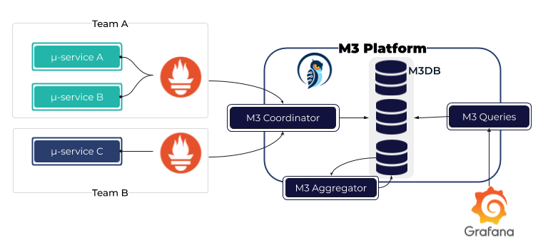
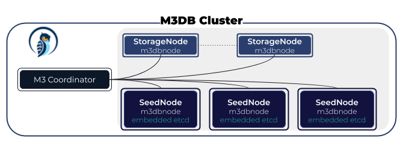
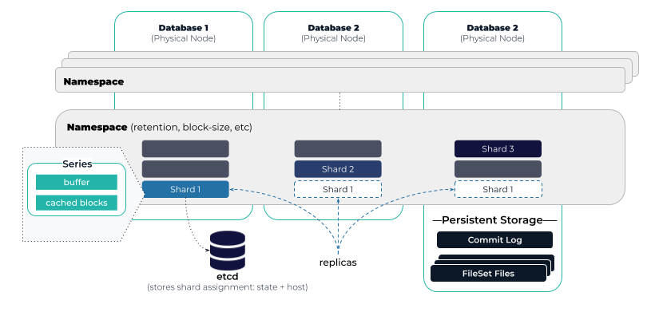

+++
author = "Florian Hussonnois"
title = "Measuring every ‘thing’ at Scale! An introduction to time-series with M3"
date = "2020-09-23"
tags = [
    "m3",
    "time series",
    "prometheus",
    "monitoring",
]
draft = false
image = "/images/posts/m3-time-series/m3-platform.png"
+++

_This blog post was originally published on [Medium](https://medium.com/streamthoughts/measuring-every-thing-at-scale-an-introduction-to-time-series-with-m3-a1e8d81465c)_

Today, it’s easy to say that almost everything we do, everything we use, and even everything around us is capable of producing data. But what is even more true, is that this **data** is produced **in real-time** to describe something that is happening.

Therefore, it’s logical to think that data must be also harnessed in real-time to be able to extract the most value from it. In addition, and perhaps most importantly, data must be stored and processed with a **temporal context** to retain its full significance. This is actually the condition necessary to fully understand the context in which something exists or occurred.

So, let’s take some real-life examples where the temporal context (i.e., time) is an essential part of the meaning of your data:

- Recording sports performance metrics (i.e. speed, position, heart rate) during a sporting activity through a connected watch.
- Measuring atmospheric conditions to provide data for weather forecasts (wind speed, temperature, atmospheric pressure, etc).
- Monitoring of a server’s system resource usage.
- Monitoring of a home’s energy consumption.
- Monitoring stock prices, etc.

All of these examples have one thing in common: they are all about data that we want to measure over time to monitor their evolution, to detect or predict trends (maybe in correlation with other events), or to alert on thresholds. We more commonly refer to these data as **time-series**.

The explosion of the IoT ([**Internet of Things**](https://en.wikipedia.org/wiki/Internet_of_things)) in recent years has greatly accelerated the need to be able to efficiently store and analyze this data, which most often means millions of new metrics produced every second.

## What is a time-series and what is a time-series database (TSDB)?

Time-series are sequences of numeric data points that are generated in successive order. Each data point represents a measure (also called a metric). Each metric has a name, a timestamp, and usually one or more labels that describe the actual object being measured.

To store such data we could perfectly use a traditional relational database (such as PostgreSQL) and create a simple SQL table like this:

```sql
CREATE TABLE timeseries (
 metric_name TEXT NOT NULL,
 metric_ts timestamptz NOT NULL DEFAULT CURRENT_TIMESTAMP,
 value double precision NOT NULL,
 labels json,
 PRIMARY KEY(metric_name, metric_ts) 
 );
```

And, for example, to query and aggregate every point from now to the last 10 minutes we could use a SQL query similar to:

```sql
SELECT avg(value) FROM timeseries WHERE metric_name = 'heart_rate_bpm' AND metric_ts >= NOW() - INTERVAL '10 minutes';
```

However, this solution would not be really effective for data-intensive applications and long-term use. And sooner or later we would probably be limited by:

- The horizontal scalability capabilities, whether for long-term storage, resiliency, or multi-region deployment needs.
- The ability to massively insert millions of metrics per second (most relational databases are based on B-TREE index structures).
- The ability to automatically roll-up data over time. For example, to aggregate all metrics from the previous month into 5-minute points).

Also, there are likely hotspots when inserting very high throughput measurements. This can lead to poor performance, depending on the type of index used by the database, due to concurrent accesses.

For all of these reasons, it‘s usually preferable to use solutions that are specifically designed to enable efficient storage and querying of this kind of data. These solutions are called time-series databases (TSDB).

Below are some of the most known TSDB:

- [**InfluxDB**](https://www.influxdata.com/)
- [**TimescaleDB**](https://www.timescale.com/)
- [**OpenTSDB**](http://opentsdb.net/)

Finally, there are also other very popular solutions such as [**Prometheus**](https://prometheus.io/) and [**Graphite**](https://graphiteapp.org/) which are sometimes (perhaps wrongly) compared to TSBDs because of their ability to store time series. But they are actually monitoring systems that use features similar to those of TSDBs for storing metrics.

In this article, we will focus on a more recent solution: [**M3DB**](https://www.m3db.io/) a distributed time series platform.

## M3, A distributed time-series database


*M3, The fully open source metrics platform built on M3DB, a distributed timeseries database*

[**M3**](https://www.m3db.io/) is a distributed time-series platform that was developed by [**Uber**](http://uber.github.io/) to meet its growing storage and access needs for the trillions of metrics that the platform generates every day around the world.

The M3 platform is available in **open-source** under the **Apache v2.0 license** since 2018 on [GitHub](https://github.com/m3db/m3). It is developed entirely in [Go](https://golang.org/) and has been designed to be able to scale horizontally in order to support both **high throughput writes** and **low-latency queries**.

The M3 platform provides key features that make it a complete and robust solution for storing and processing time-series data:

- **Cluster Management**: M3 is built on top of [**etcd**](https://etcd.io/) to provides support for handling multiple clusters out of the box.
- **Built-in replication**: Time-series data points are replicated across nodes with tunable configuration to achieve the desired balance between performance, availability, durability, and consistency.
- **Highly Compressed**: M3 provides an efficient compression algorithm inspired by [Gorilla TSZ](http://www.vldb.org/pvldb/vol8/p1816-teller.pdf).
- **Configurable Consistency**: M3 supports different consistency levels for both write and read requests (i.e: One, Quorum, All).
- **Out of order writes**: M3 can seamlessly handle out-of-order writes for a configurable period.
- **Seamless Prometheus Integration**: M3 has built-in supports PromQL and can be used as a Prometheus Long-term Storage

All these features are offered by different components that make up the M3 platform: **M3 DB**, **M3 Coordinator**, **M3 Queries** and **M3 Aggregator**.

Now, let us now take a closer look at these four components.

## M3 Components Overview

### M3 DB

**M3DB** is the actual distributed time-series database that provides durable and scalable storage as well as reverse indexes for time-series.

M3 DB relies on [**etcd**](https://etcd.io/) for clustering-management and provides synchronous replication with configurable durability and read consistency (one, majority, all, etc).

### M3 Coordinator

**M3 Coordinator** is the service, part of the M3 platform, dedicated to the coordination of reads and writes in M3DB between upstream systems. For example, it can act as a bridge with Prometheus (or other systems such as Graphite). In addition, M3 Coordinator is used as a global service to configure other components of the platform.

### Using M3DB as a Prometheus Long-term Storage

[**Prometheus**](https://prometheus.io/) is a very popular monitoring system that quickly becomes the de-facto solution to use for monitoring infrastructures and cloud-native applications (in particular, the ones that are running in Kubernetes). A key benefit of Prometheus is its ease of use and operability in production. This can be explained, among other things, by the fact that each instance of Prometheus operates independently of each other and relies only on its local storage to guarantee the durability of the data.

But this simplicity is also the source of its limitations: Prometheus wasn’t designed to be durable long-term data storage, allowing to run analysis queries on historical data. Additionally, it can’t be horizontally scaled without third-party solutions (e.g.: [Thanos](https://github.com/thanos-io/thanos), [Cortex](https://github.com/cortexproject/cortex)).

So, M3DB can be used as a remote, multi-tenant and scalable data storage for Prometheus.

### M3 Queries

**M3 Queries** is the M3 service dedicated to exposing the metrics and metadata of time series stored in M3DB. M3 Queries allows distributed query execution on an M3 cluster to interrogate both realtime and historical metrics for analytical purposes. For this purpose, M3 Queries offers two query engines: **Prometheus/PromQL** (default) and M3.

The fact that M3 Queries supports [**PromQL**](https://prometheus.io/docs/prometheus/latest/querying/basics/) by default is a huge advantage.  
Indeed, the HTTP API is compatible with the Prometheus plugin of [**Grafana**](https://grafana.com/). In this way, it is possible to easily switch out or part of a Grafana monitoring to M3 without having to rewrite the requests of its dashboards.

### M3 Aggregator

**M3 Aggregator** is the latest service that is part of the M3 platform. Its role is to aggregate the metrics, following rules stored in etcd, for sampling purposes. before they are stored in M3DB.

The diagram below illustrates how M3 can be used to federate multiple Prometheus instances:



*M3 Platform: As a Prometheus Long-term Storage*

## M3DB Architecture Overview

M3DB cluster is composed of two types of nodes: **StorageNode** and **SeedNode**.

- **StorageNode** runs the *m3dbnode* process that stores time-series and serves both write and read queries.
- **SeedNode** is similar to the StorageNode but also runs an embedded *etcd server* to manage the cluster configuration.

Usually, for very large deployment we use a dedicated *etcd cluster,* and thus only M3DB Storage nodes are deployed.

Then, in addition to these two types of nodes, we will also have multiple dedicated nodes to run **M3 Coordinator** and **M3 Queries**.

The following schema illustrates the different types of nodes.



*M3 DB Cluster Deployment Overview*

Now, let’s take a closer look at how a *StorageNode* and the storage engine of M3 DB work.

The internal architecture of a node is made of two distinct parts: an in-memory model and persistent storage.

First, the in-memory is designed according to a hierarchical object model where each node contains a single ***database*** that owns one or more ***namespace***. Then, locally to each node, a *namespace* owns multiple ***shards*** which in turn owns multiple ***Series***. Finally, each *series* owns a *buffer* and multiple ***cached blocks***.

```text
Database >Namespaces > Shards > Series > (Buffer, Cached Blockeds)
```

Secondly, to implement persistent storage, the M3DB instance uses on the one hand a ***Commit-Log***, to ensure data consistency after recovery from node failure, and on the other hand, multiple **FileSet** files to efficiently store time series, reverse indexes and metadata.

The following diagram tries to illustrate these different concepts in concise form:



*M3DB Architecture Overview: Memory Model + Persistent Storage*

Now, let’s describe the role of each of these elements.

### Namespace

A namespace has a unique name and a distinct set of configuration options (i.e. retention, block size, etc).

### Shard

Shards allow distributing the time series evenly across all the nodes. By default, 4096 virtual shards are configured. Shards are replicated and the assignment of shards to nodes is stored in etcd.

### Series

A series is a sequence of data points. Each series is associated with an ID hashed using the [*murmur3*](https://en.wikipedia.org/wiki/MurmurHash) algorithm. The hash is then used to determine the target shard that owns the series.

### Buffer

A buffer contains all data points that have not yet been written to disk (i.e. new writes) as well as some data loaded during the bootstrapping of the node. A buffer creates a block for new writes which is later flushed on disk depending on the configured block-sized.

### Block

A block contains compressed time-series data. A block is cached after a read request. A block has a fixed size that is configured when the namespace is created. For example, the size of a block can be expressed in hours or days (e.g: 2d).

### Commit Log

The commit-log is an append-only structure (equivalent to the write-ahead-log or binary log in other databases) in which every data points are written sequentially and uncompressed. The MD3B node periodically runs a snapshotting process that compacts this file. The commit-log is used for disaster recovery and can be configured to fsync every writes.

### FileSet Files

**Fileset** files are the primary unit of long-term storage for M3DB. A FileSet is used to store compressed streams of time series values for a specific shard/block.

A fileset includes all there files:

- **Info file**: Stores metadata about the fileset volume such as the block time window start and size.
- **Summaries file**: Stores a subset of the index file to keep the contents in memory and to seek to the index file for a series with a linear scan.
- **Index file**: Stores the series metadata to locate compressed time series data stream in the data file.
- **Data file**: Stores the compressed streams of time series values.
- **Bloom filter file**: Stores a bloom filter bitset for all series contained in a fileset. The bloom filter is used in the read path to determine whether or not a series exists on the disk.
- **Digests file**: Stores the digest checksums of all the files in the fileset volume for integrity verification.
- **Checkpoint file**: Stores a digest of the digests file to allows for quickly checking if a volume was completed.

## Going Further

To get started with M3, the best way is to follow the How-to page of the official documentation: [https://docs.m3db.io/how\_to/single\_node/](https://docs.m3db.io/how_to/single_node/)

The documentation also references multiple videos that introduce M3 and the motivations that led to its development at Uber: [https://docs.m3db.io/overview/media/](https://docs.m3db.io/overview/media/)

## Conclusion

**M3** is a relatively new solution that offers a **simple** and **efficient architecture** with a design similar to [Apache Cassandra](https://cassandra.apache.org/). M3 integrates **seamlessly** with existing monitoring solutions such as **Prometheus** and **Grafana** to provide scalable and durable data storage. Finally, M3 can be used both for **low-latency queries** and **analytical queries** on historical data.

## About Us

[StreamThoughts](https://www.streamthoughts.io/) is a French IT consulting company specialized in event streaming technologies and data engineering, which was founded in 2020 by a group of technical experts. Our mission is to help our customers to make values out of their data as real-time event streams through our expertise, solutions and partners.
