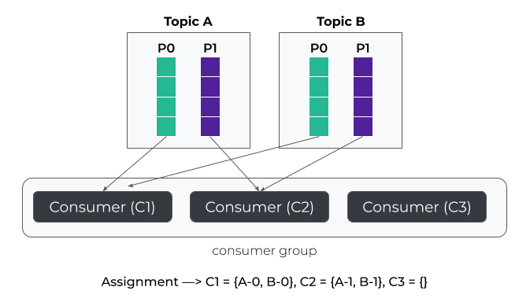
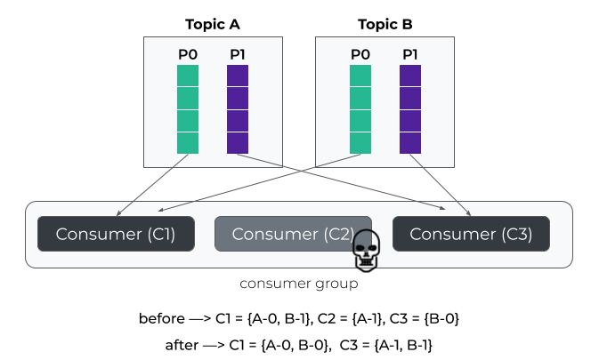
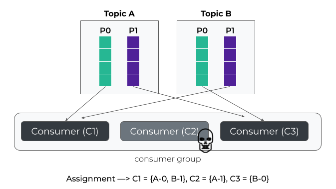
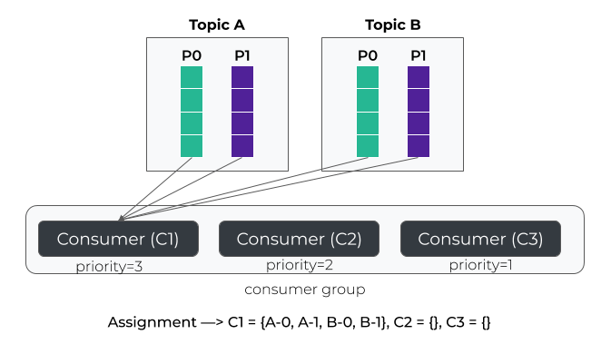
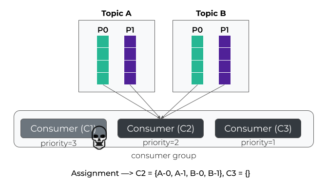

+++
author = "Florian Hussonnois"
title = "Understanding Kafka partition assignment strategies and how to write your own custom assignor"
date = "2019-11-20"
tags = [
    "apache kafka",
    "java",
    "kafka consumer",
]
draft = false
+++

_This blog post was originally published on [Medium](https://medium.com/streamthoughts/understanding-kafka-partition-assignment-strategies-and-how-to-write-your-own-custom-assignor-ebeda1fc06f3)_

In a [previous blog post](/posts/apache-kafka-rebalance-protocol-or-the-magic-behind-your-streams-applications/), I explain how the Apache Kafka Rebalance Protocol does work and how is internally used. From the point of view of Kafka consumers, this protocol is leveraged both to coordinate members belonging to the same group and to distribute topic-partition ownership amongst them.

One of the key aspect of this protocol is that, as a developer, we can embed our own protocol to customize how partitions are assigned to the group members.

In this post, we will see which strategies can be configured for Kafka Client Consumer and how to write a custom `PartitionAssignor` implementing a failover strategy.

## The PartitionAssignor Strategies

When creating a new Kafka consumer, we can configure the strategy that will be used to assign the partitions amongst the consumer instances.

The assignment strategy is configurable through the property `partition.assignment.strategy`.

The following code snippet illustrates how to specify a partition assignor:

```java
Properties props = new Properties();
...
props.put(ConsumerConfig.PARTITION_ASSIGNMENT_STRATEGY_CONFIG, StickyAssignor.class.getName());

KafkaConsumer<String, String> consumer = new KafkaConsumer<>(props);
//...
```

All consumers which belong to the same group must have one common strategy declared. If a consumer attempts to join a group with an assignment configuration inconsistent with other group members, you will end up with this exception:

```text
org.apache.kafka.common.errors.InconsistentGroupProtocolException: The group member’s supported protocols are incompatible with those of existing members or first group member tried to join with empty protocol type or empty protocol list.
```

This property accepts a comma-separated list of strategies. For example, it allows you to update a group of consumers by specifying a new strategy while temporarily keeping the previous one. Part of the Rebalance Protocol the broker coordinator will choose the protocol which is supported by all members.

A strategy is simply the fully qualified name of a class implementing the interface `PartitionAssignor.`

Kafka Clients provides three built-in strategies: **Range**, **RoundRobin** and **StickyAssignor**.

### RangeAssignor

The [*RangeAssignor*](https://kafka.apache.org/23/javadoc/org/apache/kafka/clients/consumer/RangeAssignor.html) is the default strategy. The aims of this strategy is to co-localized partitions of several topics. This is useful, for example, to join records from two topics which have the same number of partitions and the same key-partitioning logic.

For doing this, the strategy will first put all consumers in lexicographic order using the *member\_id* assigned by the broker coordinator. Then, it will put available topic-partitions in numeric order. Finally, for each topic, the partitions are assigned starting from the first consumer.



*Example: RangeAssignor*

As you can seen, partitions 0 from topics A and B are assigned to the same consumer.

In the example, at most two consumers are used because we have maximum of two partitions per topic. If you plan to consume from multiple input topics and you are not performing an operation requiring to co-localized partitions you should definitely not use the default strategy.

### RoundRobinAssignor

The `RoundRobinAssignor` can be used to distribute available partitions evenly across all members. As previously, the assignor will put partitions and consumers in lexicographic order before assigning each partitions.


*Example: RoundRobinAssignor*

Even if RoundRobin provides the advantage of maximizing the number of consumers used, it has one major drawback. Indeed, it does not attempt to reduce partition movements when the number of consumers changes (i.e. when a rebalance occurs).

To illustrate this behaviour, let’s remove the consumer 2 from the group. In this scenario, topic-partition B-1 is revoked from C1 to be re-assigned to C3. Conversely topic-partition B-0 is revoked from C3 to be re-assigned to C1.



*Example: RoundRobinAssignor with reassignment*

For example, if a consumer initializes internal caches, opens resources or connections during partition assignment, this unnecessary partition movement can have an impact on consumer performance.

### StickyAssignor

The `StickyAssignor` is pretty similar to the RoundRobin except that it will try to minimize partition movements between two assignments, all while ensuring a uniform distribution.

Using the previous example, if consumer C2 leaves the group then only partition A-1 assignment changes to C3.



### StreamsPartitionAssignor

Kafka Streams ships with its own`StreamsPartitionAssignor`. It’s used to assign partitions across application instances while ensuring their co-localization and maintaining states for active and standby tasks.

Usually, these three basic assignors are suitable for most use cases. However, you may have a specific project context or deployment policy that requires you to implement your own strategy.

For this purpose, let’s have a look on how to implement the interface `org.apache.kafka.clients.consumer.internals.PartitionAssignor`.

## Implementing a Custom Strategy

### The PartitionAssignor interface

The *PartitionAssignor* is not so much complicated and only contains four main methods.

```java
public interface PartitionAssignor {

    Subscription subscription(Set<String> topics);

    Map<String, Assignment> assign(
                         Cluster metadata, 
                         Map<String, Subscription> subscriptions);

    void onAssignment(Assignment assignment);

    String name();
}
```

First, the `subscription()` method is invoked on all consumers, which are responsible to create the *Subscription* that will be sent to the broker coordinator. A *Subscription* contains the set of topics that consumer subscribes to and, optionally, some user-data that may be used by the assignment algorithm.

Then, part of the Rebalance Protocol the consumer group leader will receives the subscription from all consumers and will be responsible to perform the partition assignment through the method `assign()`.

Next, all consumers will receive their assignment from the leader and the `onAssignment()` method will be invoked on each. This method can be used by consumers to maintain internal state.

Finally, a `PartitionAssignor`must be assigned to a unique name returned by the method `name()` (e.g. “range” or “roundrobin” or “sticky”).

### Failover strategy

With default assignors all consumers in a group can be assigned to partitions. We can compare this strategy to an active/active model which means that all instances will potentially fetch messages at the same time. But, for some production scenarios, it may be necessary to perform an active/passive consumption. Hence, I propose to you to implement a *FailoverAssignor* which is actually a strategy that can be found in some other messaging solutions.

The basic idea behind Failover strategy is that multiple consumers can join a same group. However, all partitions are assigned to a single consumer at a time. If that consumer fails or is stopped then partitions are all assigned to the next available consumer. Usually, partitions are assigned to the first consumer but for our example we will attach a priority to each of our instance. Thus, the instance with the highest priority will be preferred over others.

Let’s illustrate this strategy. In the example below, C1 has the highest priority, so all partitions are assigned to it.



If the consumer fails, then all partitions are assigned to the next consumer (i.e C2).



### Implementation

First, let’s create a new Java classes so-called `*FailoverAssignor*`*.* Instead of implementing the interface `PartitionAssignor`, we will extend the abstract class `AbstractPartitionAssignor`. This class already implements the `assign(Cluster,Map<String, Subscription>)` method and does all the logic to get available partitions for each subscription. It also declares the following abstract method that we will have to implement:

```java
Map<String, List<TopicPartition>> assign(
                           Map<String, Integer> partitionsPerTopic,
                           Map<String, Subscription> subscriptions);
```

But before we do that, we need to make our `FailoverAssignor` configurable, so that we can assign a priority to each consumer. Fortunately, Kafka provides the interface `Configurable` that we can implement to retrieve the client configuration.

The complete code so far is this:

```java
public class FailoverAssignor extends AbstractPartitionAssignor implements Configurable {

  @Override
  public String name() {
    return "failover";
  }

  @Override
  public void configure(final Map<String, ?> configs) { 
    // TODO
  }

  @Override
  public Subscription subscription(final Set<String> topics) { 
    // TODO
  }

  @Override
  Map<String, List<TopicPartition>> assign(
                         Map<String, Integer> partitionsPerTopic,
                         Map<String, Subscription> subscriptions) {
    // TODO
  }
}
```

In the code above, the method `configure` is invoked just after the initialization of the `FailoverAssignor` instance by the `KafkaConsumer`.

To follow the Kafka coding convention, we are going to create a second class so-called `FailoverAssignorConfig` that will extend the common class `AbstractConfig`:

```java
public class FailoverAssignorConfig extends AbstractConfig {

    public static final String CONSUMER_PRIORITY_CONFIG = "assignment.consumer.priority";
    public static final String CONSUMER_PRIORITY_DOC = "The priority attached to the consumer that must be used for assigning partition. " +
            "Available partitions for subscribed topics are assigned to the consumer with the highest priority within the group.";

    private static final ConfigDef CONFIG;

    static {
        CONFIG = new ConfigDef()
                .define(CONSUMER_PRIORITY_CONFIG,             ConfigDef.Type.INT, Integer.MAX_VALUE,
                        ConfigDef.Importance.HIGH, CONSUMER_PRIORITY_DOC);
    }

    public FailoverAssignorConfig(final Map<?, ?> originals) {
        super(CONFIG, originals);
    }

    public int priority() {
        return getInt(CONSUMER_PRIORITY_CONFIG);
    }
}
```

Now, the `configure()` method can be simply implemented as follows:

```java
public void configure(final Map<String, ?> configs) {
    this.config = new FailoverAssignorConfig(configs);
}
```

Then, we need to implement the `subscription()` method in order to share the consumer priority through the user-data field. Note, that the user-data has to be passed as byte-buffer.

```java
@Override
public Subscription subscription(final Set<String> topics) {
    ByteBuffer userData = ByteBuffer.allocate(4)
      .putInt(config.priority())
      .flip();
    return new Subscription(
        new ArrayList<>(topics), 
        ByteBuffer.wrap(userData)
     );
}
```

Next, we can implement the `assign()` method:

```java
@Override
public Map<String, List<TopicPartition>> assign(
                   Map<String, Integer> partitionsPerTopic,
                   Map<String, Subscription> subscriptions) {

// Generate all topic-partitions using the number 
// of partitions for each subscribed topic.
final List<TopicPartition> assignments = partitionsPerTopic
    .entrySet()
    .stream()
    .flatMap(entry -> {
        final String topic = entry.getKey();
        final int numPartitions = entry.getValue();
        return IntStream.range(0, numPartitions)
            .mapToObj( i -> new TopicPartition(topic, i));
    }).collect(Collectors.toList());

// Decode consumer priority from each subscription and
Stream<ConsumerPriority> consumerOrdered = subscriptions.entrySet()
    .stream()
    .map(e -> {
        int priority = e.getValue().userData().getInt();
        String memberId = e.getKey();
        return new ConsumerPriority(memberId, priority);
    })
    .sorted(Comparator.reverseOrder());

// Select the consumer with the highest priority
ConsumerPriority priority = consumerOrdered.findFirst().get();

final Map<String, List<TopicPartition>> assign = new HashMap<>();
subscriptions.keySet().forEach(memberId -> assign.put(memberId, Collections.emptyList()));
assign.put(priority.memberId, assignments);
return assign;
}
```

Finally, we can use our custom partition assignor like this:

```java
Properties props = new Properties();
...
props.put(
    ConsumerConfig.PARTITION_ASSIGNMENT_STRATEGY_CONFIG,   
    FailoverAssignor.class.getName()
);
props.put(FailoverAssignorConfig.CONSUMER_PRIORITY_CONFIG, "10");

KafkaConsumer<String, String> consumer = new KafkaConsumer<>(props);
```

## Conclusion

Kafka Clients allows you to implement your own partition assignment strategies for consumers. This can be very useful to adapt to specific deployment scenarios, such as the failover example we used in this post. In addition, the ability to transmit user data to the consumer leader during rebalancing can be leveraged to implement more complex and stateful algorithms, such as one developed for Kafka Stream

You can find the complete source code to [GitHub](https://github.com/streamthoughts/kafka-consumer-partition-assignor).

About Us:

[StreamThoughts](https://www.streamthoughts.io/) is an open source technology consulting company. Our mission is to inspire companies to create ever more innovative services that make the most of the opportunities offered by real-time data streaming.

We deliver high-quality professional [services](https://www.streamthoughts.io/services/apache-kafka/) and [training](https://www.streamthoughts.io/training/), in France, on the Apache Kafka ecosystem and Confluent.Inc Streaming platform.
